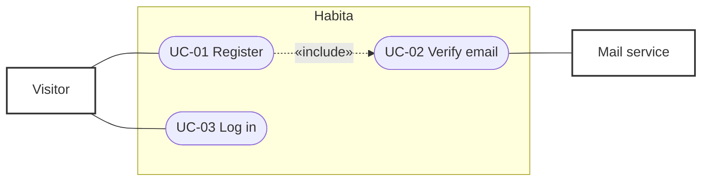
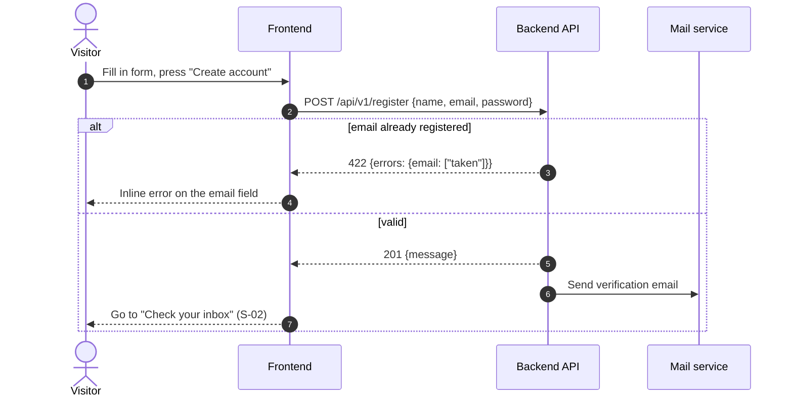

```mermaid
flowchart TD
    subgraph Visitor
        S((" ")):::start --> A1("Submit registration form")
    end
    subgraph System
        A1 --> D1{"Email already registered?"}
        D1 -- "yes" --> A2("Show 'email taken' error")
        D1 -- "no" --> A3("Create account and send verification email")
    end
    A2 --> E1(((" "))):::endNode
    A3 --> E2(((" "))):::endNode
    classDef start fill:#000,stroke:#000
    classDef endNode fill:#000,stroke:#000,stroke-width:4px
```

# Diagram files

Three files, all Mermaid, all in the PRD folder. Each starts with a one-line title, a link back to `prd.md`, and then its diagrams, each under its own heading with the UC id in it so a reader can jump between files.

## `use-cases.md`

A diagram, then a spec per use case.

**Diagram.** Mermaid has no use case diagram type, so draw it as a flowchart: actors outside a boundary box, one ellipse (stadium) per use case inside it. Use dotted arrows for `include` / `extend`. If the PRD has several parts or many use cases, draw one diagram per part so none gets unreadable.

````markdown

````

**Spec per use case** (a table keeps them scannable):

```markdown
### UC-01 Register
| | |
|---|---|
| Actor | Visitor |
| Goal | |
| Preconditions | |
| Trigger | |
| Main flow | 1. … 2. … |
| Alternate flows | 2a. If the email is already used … |
| Postconditions | |
| Requirements | FR-01, FR-02 · BR-03 |
```

## `activity-diagrams.md`

One activity diagram per use case that has more than a straight line of steps, for example branching, loops, several actors or error handling. For a trivial use case, write "No diagram: a single step" under its heading rather than leaving it out silently.

Use a flowchart with these conventions so it reads as UML:

- Start: filled circle `S((" "))`; end: `E(((" ")))`, with the `start` / `endNode` classes below to fill them.
- Actions: rounded rectangles `A("Verb the thing")`. Decisions: diamonds `D{"Question?"}`, every outgoing arrow labelled.
- Swimlanes: one `subgraph` per actor or system, so who does what is visible. Keep arrows between lanes; they are the hand-offs.
- Parallel work: split into two arrows from one node and merge them again, and say "in parallel" in the label (Mermaid has no fork bar).
- Cover the unhappy paths that matter (validation failure, expired link, permission denied), because the plan's tests are derived from them.

````markdown

````

## `sequence-diagrams.md`

Use `sequenceDiagram`. One diagram per significant interaction: the main success path of each user-facing use case, plus one for any cross-cutting behaviour (token refresh, retries). Show the failures that change the flow with `alt` / `opt`.

- Participants: the actor, `Frontend`, `Backend API`, and any external system (mail, payment). Keep to that level. Internals of the backend (controllers, jobs, models) belong in the build plan, and showing them here would leak the backend's architecture to the frontend plan.
- Message text uses the real method and path from the PRD's interface contract (`POST /api/v1/register`) and names the key fields or status codes, so the contract and diagrams can be checked against each other.
- Use `autonumber`, and `Note over` for rules worth stating (`BR-04`).

````markdown

````

## Keeping Mermaid parseable

- Quote every flowchart label that contains parentheses, colons, quotes or slashes: `A1("Submit form (step 1)")`. Use single quotes inside a quoted label.
- Don't use `end` as a node id or label. Use `Done` or `E1`.
- Node ids can't contain spaces or hyphens; use `UC01`, not `UC-01`, in ids, and put `UC-01` in the label.
- In sequence diagrams, avoid `;` and `#` in message text (they end the line or start an entity).
- If a diagram has more than about 15 nodes, split it. Wide diagrams are unreadable in Markdown previews.
