# BRD-standard-project-bootstrap — Platform bootstrap: admin access control and audience accounts

| Field | Value |
|---|---|
| Document ID | BRD-standard-project-bootstrap |
| Version | 1.0 |
| Date | 2026-11-05 |
| Status | Approved and delivered. Part A (admin access control) and Part B (audience accounts) are built and merged in both repos. One Part B milestone, the live-API test run (FE-M3, issue #9), is still open: see §G7 |
| Product | Habita: admin dashboard and audience web app |
| Repos affected | `habita-backend` (Laravel 13, Postgres, JWT), `habita-frontend` (React 19 + Vite, JavaScript) |
| Replaces | BRD-001 v0.3 (admin access control, approved 2026-10-26) and BRD-002 v0.1 (audience accounts, approved 2026-11-01). Both are merged into this document |
| Companion files | [intent.md](intent.md) · [acceptance.md](acceptance.md) · build plans: the delivered `plan` GitHub issues in §G7 |
| Wireframes | Figma only: file [Habita](https://www.figma.com/design/Knmt6pvU4GRvL3M5dCd1Mj/Habita?node-id=0-1), page "BRD-standard-project-bootstrap", sections "Admin (ADM)" and "Audience (AUD)". There are no local prototype files |

**Change log**

| Version | Date | Change |
|---|---|---|
| 1.0 | 2026-11-05 | Merged BRD-001 v0.3 and BRD-002 v0.1 into one BRD. Every requirement-style ID is prefixed `ADM-` (Part A) or `AUD-` (Part B) so the two cannot collide. Wireframes, flow maps and Interactions panels moved from local `*.dc.html` files and the Claude Design canvas to Figma. Duplicated definitions moved into one shared section (§G4). Planning-time "as-is" sections replaced by as-built notes verified against the code on 2026-11-05. Developer-internal detail (class and middleware names, framework rule syntax) removed from the requirements. Status set to approved and delivered |
| BRD-001 v0.3 | 2026-10-26 | Source BRD. v0.2 added the screen flow map, interaction tables, navigation criteria and decisions ADM-D-10, ADM-D-11. v0.3 added route-level permission checks and per-request token rotation (ADM-FR-AUTH-12, ADM-FR-AUTH-13, ADM-FR-AZ-05) |
| BRD-002 v0.1 | 2026-11-01 | Source BRD. Audience sign-up, email verification, login, sessions, forgot and reset password |

---

## G1. How to use this document

This BRD is the finished specification of what was built. Use it to understand, test or extend the platform bootstrap.

1. Read §G2 to §G7 first. They hold what both parts share. Then read the part you need: **Part A** (§A1 to §A18, IDs prefixed `ADM-`) or **Part B** (§B1 to §B18, IDs prefixed `AUD-`).
2. Section references inside a part are written with the part letter, such as `§A12.7` (Part A, section 12.7) and `§B13.5`. Requirement IDs always carry their prefix: `ADM-BR-06`, `AUD-FR-UI-04`, `ADM-IX-S10-05`.
3. Every requirement cites the IDs it fulfils. Those sections are the spec. Do not invent behaviour that isn't written here.
4. If something is ambiguous or contradicts the codebase, stop and ask. Record the question in the part's decisions, questions and risks section (§A17 or §B17).
5. Exact strings (messages, labels, permission names, email text) are normative. Copy them verbatim.
6. **For UI work, three things together are the spec**: the Figma frames (layout and copy), the screen flow map (the Mermaid copy in §A9.4 and §B9.3 is the normative text version), and the interaction tables (§A12.7 and §B12.7). A control's behaviour is its **IX** row. Each IX row needs a UI test whose title contains its ID (`ADM-AC-NAV-09`, `AUD-AC-NAV-07`).
7. Follow each repo's own rules files (`habita-backend/AGENTS.md`, `habita-frontend/CLAUDE.md`). Model, class and middleware-level changes belong in the build plans, not in this BRD.

### G1.1 Wireframes live in Figma

All wireframes are in one Figma file, [Habita](https://www.figma.com/design/Knmt6pvU4GRvL3M5dCd1Mj/Habita?node-id=0-1), on the page "BRD-standard-project-bootstrap". The page has two sections:

| Section | Part | Contents |
|---|---|---|
| Admin (ADM) | A | A flow map (`ADM-S-00`) and one frame per admin screen and dialog |
| Audience (AUD) | B | A flow map (`AUD-S-00`) and one frame per audience screen and card state |

Conventions that apply to every frame (the owner asked for these):

- **Flow map.** The first board of a section draws every screen as a card, with an arrow for every navigation. Each arrow is labelled with the IX ID of the control that triggers it. Dialogs hang off the screen that opens them. The Mermaid maps in §A9.4 and §B9.3 are the text copy.
- **Numbered controls.** Every control that does something carries a small numbered badge. The number is the last part of the control's IX ID (badge 5 on `ADM-S-10` is `ADM-IX-S10-05`).
- **Interactions panel.** Each screen frame is followed by an "Interactions" panel listing its badges: trigger, request, result and destination.
- **Source of truth.** The IX tables in this document are normative. If an Interactions panel and an IX table disagree, the table wins and the Figma panel is a bug.

The screens were first drawn as local `prototypes/project/*.dc.html` files on a Claude Design canvas. Those files and that canvas are retired. Figma replaces them.

---

## G2. Purpose and scope of the bootstrap

### G2.1 Purpose

Bootstrap the Habita platform so that it knows who its users are and what each of them may do:

- **Staff** get a web admin panel to manage roles, permissions and administrative users (Part A).
- **The audience** can create an account, prove they own their email, log in, stay logged in and recover a forgotten password (Part B).

Long-term, Habita is a habit-building mobile and web app. This bootstrap is the foundation for later admin features and for every later audience feature.

### G2.2 Scope of the whole bootstrap

| Part | In scope | Detail |
|---|---|---|
| A | Admin login, logout and session; roles, permissions and administrative users; two seeded tiers (Super Admin, Admin); the access-control seeder and the first-Super-Admin command | §A2 |
| B | Register, email verification, audience login, Remember me, session restore and refresh, logout, forgot and reset password, two Markdown emails with a local development inbox, a marked placeholder for the audience home | §B2 |
| Shared | One user store and one set of account states, one email rule, one password policy, JWT sessions with separate admin and audience scopes | §G4 |

### G2.3 Out of scope (both parts)

Each part lists its own exclusions in §A2.2 and §B2.2. The main ones: restoring soft-deleted users, self-service profile and change-password screens, social login, audit log, a real mail provider, the audience home design, Terms of Service and Privacy Policy pages, translations and the mobile apps.

---

## G3. Actors and shared glossary

| Actor | Part | Description |
|---|---|---|
| Super Admin | A | Seeded role `super-admin`. Full control of access control. |
| Admin | A | Seeded role `admin`. Day-to-day user support. |
| Visitor | B | Not logged in. Can register, verify, log in, and request or complete a reset. |
| Account holder | B | Logged in with an audience token. |
| System | A, B | Issues and checks tokens, sends mail, enforces limits and rules. |

Part-specific actors and terms are in §A3, §A4, §B3 and §B4. Terms used by both parts:

| Term | Meaning |
|---|---|
| **User** | A row in the shared user store. Staff and audience accounts are both users. |
| **Staff account** | A user who holds at least one role. |
| **Audience account** | A user who holds no roles, usually created by Register (Part B). |
| **Active / Deactivated / Soft-deleted** | Account states. See `SH-01`. |
| **JWT** | JSON Web Token, used as a bearer access token by the web app. |
| **Admin token / audience token** | A JWT issued by the admin login or by the audience login. They are not interchangeable (`AUD-BR-13`). |

---

## G4. Shared rules

Both parts rely on these rules. They are defined once here. The parts' own rules point back to them, and keep their original IDs.

| ID | Rule | Used by |
|---|---|---|
| **SH-01** | **Account states.** *Active*: `users.deactivated_at` is null. *Deactivated*: `deactivated_at` is set. The account cannot log in, and a token it already holds is rejected with `403` and `code: "account_deactivated"` (message "Your account has been deactivated."). *Soft-deleted*: `users.deleted_at` is set. The account cannot log in, no query returns it, and a token it holds is rejected with `401`. *Verified* (Part B only): `users.email_verified_at` is set. | `ADM-BR-03`, `ADM-BR-04`, `AUD-BR-06`, `AUD-BR-07` |
| **SH-02** | **Email.** Addresses are unique across all users, including soft-deleted ones. Comparison is case-insensitive, and addresses are trimmed and stored lower-cased. A deleted user's email cannot be reused. The taken-email message is "This email is already in use." | `ADM-BR-05`, `AUD-BR-02` |
| **SH-03** | **Password policy.** At least 12 characters, with at least one upper-case letter, one lower-case letter and one digit. The hint and error text is "At least 12 characters with upper- and lower-case letters and a number." | `ADM-BR-13`, `AUD-BR-03` |
| **SH-04** | **Login throttling.** At most 5 failed attempts per minute per (email + IP). The next attempt gets `429` with "Too many login attempts. Please try again in N seconds.", where N is the real wait, plus a `Retry-After` header. A successful login clears the count. Only wrong credentials count as failed. The admin login and the audience login each keep their own counter. | `ADM-BR-20`, `AUD-BR-08` |
| **SH-05** | **Tokens.** Sessions use JWT bearer tokens. A token lasts 60 minutes and can be refreshed up to 24 hours after login (an audience login with Remember me gets a 30-day token that cannot be extended, `AUD-BR-12`). Logout blacklists the token at once. The admin API refuses audience tokens, and the audience API refuses admin tokens, both with `401` (`AUD-BR-13`, `AUD-FR-SES-06`). | `ADM-NFR-01`, `AUD-BR-12`, `AUD-BR-13`, `AUD-NFR-01` |
| **SH-06** | **Wrong credentials never reveal the account.** A wrong password, an unknown email and a soft-deleted account all get the same `401` with "These credentials do not match our records." Deactivated and unverified states are reported only after the password is verified. | `ADM-FR-AUTH-02`, `ADM-FR-AUTH-03`, `AUD-BR-11`, `AUD-FR-SES-02`, `AUD-FR-SES-03` |

---

## G5. How the two parts relate

- **One user store.** Audience accounts are users with no roles. They appear in the admin Users list (`ADM-UC-10`), where an admin can open, deactivate, reactivate or delete them under Part A's rules (`AUD-BR-01`, `AUD-D-01`, `AUD-AC-ADM-03`). An audience account has no permission, so it can never log in to the admin panel or call an admin route.
- **Admin-created users are unverified for audience login.** `ADM-UC-11` (create admin user) and the first-Super-Admin command do not verify the user's email. If such a user tries the audience login, they are told to verify first (`AUD-BR-04`). Admin login does not need verification. Forgot password, which also verifies the account (`AUD-BR-15`), or Resend email fixes it.
- **Verified staff can also use the audience app.** The audience login looks at the password, state and verification only. It does not check roles, so a verified staff account (such as the development Super Admin) can log in to the audience app too. That grants no admin rights.
- **Deactivation and deletion are shared.** Deactivating a user in the admin panel ends their audience sessions at the next request, and blocks audience login, verification links, reset links and mail (`AUD-BR-06`, `AUD-D-09`). Deleting them has the same effect with `401` (`AUD-BR-07`).
- **Password changes end audience sessions.** A password changed by an admin (`ADM-UC-13`) or by a reset invalidates every audience token issued before that moment (`AUD-BR-16`, `AUD-D-22`). Admin tokens keep Part A's behaviour (`ADM-Q-04`).
- **Separate APIs, separate token scopes.** Admin routes live under `/api/v1/admin/*`, audience routes under `/api/v1/auth/*`. Neither accepts the other's tokens (`SH-05`).
- **Separate screens.** The admin panel lives under `/admin` in the web app. The audience screens own `/`, `/login`, `/register`, `/forgot-password` and `/reset-password`, and unknown URLs outside `/admin` go to `/` (`AUD-D-14`). The admin panel's look is unaffected by the audience styling (`AUD-FR-UI-18`).
- **Same message wording.** Where both parts show the same situation they use the same text: the wrong-credentials, deactivated, session-expired and generic-error messages.

---

## G6. Combined index

### G6.1 Parts and ID families

| Part | Prefix | Title | API base | Web routes |
|---|---|---|---|---|
| A | `ADM-` | Admin panel: access control (users, roles, permissions) | `/api/v1/admin` (25 endpoints, §A13.1) | `/admin/*` |
| B | `AUD-` | Audience accounts: sign-up, verification and password recovery | `/api/v1/auth` (9 endpoints, §B13.1) | `/`, `/register`, `/login`, `/forgot-password`, `/reset-password` |
| Shared | `SH-` | Shared rules | — | — |

ID families inside a part (each carries the part prefix): `BR-` business rule · `UC-` use case · `FR-` functional requirement · `NFR-` non-functional requirement · `AC-` acceptance criterion · `D-` decision · `Q-` open question · `R-` risk · `T-` build task · `S-` screen · `IX-` screen interaction · `S1…` in-scope capability and `O1…` out-of-scope item.

### G6.2 Use cases

| Part | Use cases |
|---|---|
| A | `ADM-UC-01` Log in · `ADM-UC-02` Log out · `ADM-UC-10` List and search users · `ADM-UC-11` Create admin user · `ADM-UC-12` Update user info · `ADM-UC-13` Change user password · `ADM-UC-14` Assign roles · `ADM-UC-15` Deactivate or reactivate · `ADM-UC-16` Soft-delete user · `ADM-UC-20…23` Roles · `ADM-UC-30…33` Permissions |
| B | `AUD-UC-01` Register · `AUD-UC-02` Verify email · `AUD-UC-03` Resend verification · `AUD-UC-04` Log in · `AUD-UC-05` Stay logged in · `AUD-UC-06` Log out · `AUD-UC-07` Request password reset · `AUD-UC-08` Reset password |

### G6.3 Screens (Figma frames)

| Part | Screens |
|---|---|
| A | `ADM-S-00` flow map · `ADM-S-01` Login · `ADM-S-10` Users list · `ADM-S-11` Create user · `ADM-S-12` Edit user · `ADM-S-13` Change password dialog · `ADM-S-14` Delete user dialog · `ADM-S-15` Deactivate dialog · `ADM-S-20` Roles list · `ADM-S-21` Role form · `ADM-S-22` Delete role dialog · `ADM-S-30` Permissions list · `ADM-S-31` Permission form · `ADM-S-32` Delete permission dialog · `ADM-S-99` System states |
| B | `AUD-S-00` flow map · `AUD-S-01` Register · `AUD-S-01b` Check your email · `AUD-S-02` Log in · `AUD-S-03` Forgot password · `AUD-S-03b` Check your email · `AUD-S-04` Reset password · `AUD-S-04b` Password updated · `AUD-S-04c` Link expired · `AUD-S-05` Home placeholder |

### G6.4 Where to find things

| Looking for | Part A | Part B |
|---|---|---|
| Business rules | §A6 | §B6 |
| Data requirements | §A7 | §B7 |
| Use cases | §A8 | §B8 |
| UML (use case, activity, sequence, state) | §A8.1, §A9, §A10, §A11 | §B8.1, §B9, §B10, §B11 |
| Functional requirements | §A12 | §B12 |
| Screen interactions (IX) | §A12.7 | §B12.7 |
| API contract | §A13 | §B13 |
| UI copy and email text | §A14 | §B14 |
| Acceptance criteria | §A15 | §B15 |
| Non-functional requirements | §A16 | §B16 |
| Decisions, questions, risks | §A17 | §B17 |
| Traceability | §A18 | §B18 |

---

## G7. Delivery and the local environment

### G7.1 Delivery

All build plans were GitHub issues labelled `plan`. Both repos work from their own files, so nothing a build session needs lives only in this folder or in Figma.

| Part | Repo | Milestone | Plan issue | Merged PR | State (checked 2026-11-05) |
|---|---|---|---|---|---|
| A | habita-backend | M1 API foundation and access-control data | [#3](https://github.com/alvibd/Habita-backend/issues/3) | [#7](https://github.com/alvibd/Habita-backend/pull/7) | Closed, merged 2026-10-31 |
| A | habita-backend | M2 Admin authentication API | [#4](https://github.com/alvibd/Habita-backend/issues/4) | [#7](https://github.com/alvibd/Habita-backend/pull/7) | Closed, merged 2026-10-31 |
| A | habita-backend | M3 Permissions and roles API | [#5](https://github.com/alvibd/Habita-backend/issues/5) | [#7](https://github.com/alvibd/Habita-backend/pull/7) | Closed, merged 2026-10-31 |
| A | habita-backend | M4 Users API and permission matrix | [#6](https://github.com/alvibd/Habita-backend/issues/6) | [#7](https://github.com/alvibd/Habita-backend/pull/7) | Closed, merged 2026-10-31 |
| A | habita-frontend | M1 App shell, auth and shared UI | [#2](https://github.com/alvibd/habita-frontend/issues/2) | [#6](https://github.com/alvibd/habita-frontend/pull/6) | Closed, merged 2026-10-31 |
| A | habita-frontend | M2 Permissions and roles screens | [#3](https://github.com/alvibd/habita-frontend/issues/3) | [#6](https://github.com/alvibd/habita-frontend/pull/6) | Closed, merged 2026-10-31 |
| A | habita-frontend | M3 Users screens | [#4](https://github.com/alvibd/habita-frontend/issues/4) | [#6](https://github.com/alvibd/habita-frontend/pull/6) | Closed, merged 2026-10-31 |
| A | habita-frontend | M4 Live API integration | [#5](https://github.com/alvibd/habita-frontend/issues/5) | [#6](https://github.com/alvibd/habita-frontend/pull/6) | Closed, merged 2026-10-31 |
| B | habita-backend | M1 Accounts and verification mail | [#8](https://github.com/alvibd/Habita-backend/issues/8) | [#10](https://github.com/alvibd/Habita-backend/pull/10) | Closed, merged 2026-11-02 |
| B | habita-backend | M2 Audience sessions and password reset | [#9](https://github.com/alvibd/Habita-backend/issues/9) | [#11](https://github.com/alvibd/Habita-backend/pull/11) | Closed, merged 2026-11-02 |
| B | habita-frontend | M1 Shell, Register and Log in | [#7](https://github.com/alvibd/habita-frontend/issues/7) | [#10](https://github.com/alvibd/habita-frontend/pull/10) | Closed, merged 2026-11-02 |
| B | habita-frontend | M2 Password recovery | [#8](https://github.com/alvibd/habita-frontend/issues/8) | [#11](https://github.com/alvibd/habita-frontend/pull/11) | Closed, merged 2026-11-02 |
| B | habita-frontend | M3 Live API integration | [#9](https://github.com/alvibd/habita-frontend/issues/9) | — | **Open.** The audience live tests (`AUD-AC-LIVE-01…03`) have not been added to the live test suite yet |

The Part A milestones of each repo were delivered as one pull request.

### G7.2 Local environment (as built)

The hub's `docker-compose.yml` (in `/mnt/d/habita`) starts the backend and the frontend together by including both repos' compose files. Each repo's own compose file still works on its own.

| Service | Address or detail |
|---|---|
| Web app (Vite) | `http://localhost:5173` (`FRONTEND_URL`). Admin panel at `http://localhost:5173/admin` |
| API (Laravel) | `http://localhost:8000` in the local stack, because the backend's local `.env` sets `APP_PORT=8000` and `APP_URL=http://localhost:8000`. The web app's `.env.local` sets `VITE_API_BASE_URL=http://localhost:8000`. The checked-in `.env.example` files default to port 80 (`http://localhost`). Whatever the port, `APP_URL` must match the address the API answers on, because queued mail builds its links from it (`AUD-R-02`) |
| Mail inbox (Mailpit) | `http://localhost:8025`. SMTP on `mailpit:1025` inside the stack. Nothing leaves the machine |
| Queue worker | A `queue` service sends mail in the background (`AUD-FR-MAIL-02`) |
| Postgres, Redis | `5432`, `6379` |
| Dev data | `php artisan migrate:fresh --seed` runs `DatabaseSeeder`, which runs the access-control seeder and creates a development Super Admin, `test@example.com`, with the factory password `password`. For local development only, never for a shared or production environment. `php artisan app:create-super-admin` creates a real first Super Admin |

Commands run from `/mnt/d/habita`, for example `docker compose exec laravel.test php artisan migrate`.

---

## Part A — Admin access control (`ADM-`)

The admin panel: who can administer Habita, and what each of them may do. IDs in this part carry the prefix `ADM-`.

## A1. Purpose

Give Habita staff a web admin panel to manage **who can administer the platform** and **what each of them may do**. That means managing:

- **Roles**: named bundles of permissions.
- **Permissions**: atomic capabilities checked by the code.
- **Administrative users**: staff accounts, their roles, and their status.

This part covers the admin dashboard's access-control module, which is the foundation for later admin features.

## A2. Scope

### A2.1 In scope
| # | Capability |
|---|---|
| ADM-S1 | Admin login page, logout, and session handling (JWT) |
| ADM-S2 | Roles: create, list, view, update, delete, and assign permissions to a role |
| ADM-S3 | Permissions: create, list, view, update, delete |
| ADM-S4 | Users: create admin user, list, view, update info, change password, assign roles, deactivate and reactivate, soft-delete |
| ADM-S5 | Two seeded tiers: **Super Admin** (everything) and **Admin** (limited user management) |
| ADM-S6 | Seeder for the access-control catalogue, and an Artisan command that creates the first Super Admin |

### A2.2 Out of scope (explicitly)
| # | Item | Note |
|---|---|---|
| ADM-O1 | Restoring soft-deleted users | Future BRD. Deleted users are hidden everywhere. |
| ADM-O2 | Direct user↔permission assignment (`permission_user` table) | The table exists (Laratrust) but the panel doesn't use it. Permissions reach users **only via roles**. |
| ADM-O3 | Self-service "my profile / change my own password" | Future BRD. See ADM-BR-12. |
| ADM-O4 | Forgot-password / password-reset email for staff | Future BRD. Audience accounts have it (Part B). The admin login has no forgot-password link. |
| ADM-O5 | Email verification, welcome emails, notifying a user of a password change | The Super Admin shares credentials out-of-band. Users created here are unverified for audience login (§G5). |
| ADM-O6 | Audit log of admin actions | Recommended for the future (ADM-Q-03). |
| ADM-O7 | End-user (habit app) login, and the mobile app | Audience login is Part B. The login endpoint in this part is admin-only. |
| ADM-O8 | Laratrust teams | `laratrust.teams.enabled` stays `false`. |
| ADM-O9 | Protecting system roles/permissions from edit or delete | Product-owner decision ADM-D-05. See risk ADM-R-01. |

## A3. Glossary

| Term | Meaning |
|---|---|
| **Actor** | The logged-in admin performing an action. |
| **Target** | The user record being acted upon. |
| **Effective permissions of a user**, `P(user)` | Set of permission names the user holds through all roles. |
| **Permissions of a role**, `P(role)` | Set of permission names attached to the role. |
| **Assignable role** | A role the actor may give to a user. See ADM-BR-06. |
| **Manageable user** | A target the actor may modify. See ADM-BR-07. |
| **Active / Deactivated / Soft-deleted** | Account states, defined once in `SH-01` (§G4). |
| **Super Admin / Admin** | Seeded roles `super-admin` / `admin` (§A7.2). |

## A4. Actors

| Actor | Description | Seeded role |
|---|---|---|
| Super Admin | Full control of access control, including roles, permissions and all user operations. | `super-admin` |
| Admin | Day-to-day user support: view users, edit their name and email, deactivate or reactivate, assign roles they are allowed to assign. | `admin` |
| Unauthenticated visitor | Can only see the login page. | — |
| Audience account holder | A user with no roles (Part B). Appears in the Users list. Cannot use the admin panel. | — |
| System (backend) | Issues and validates tokens, enforces rules. | — |

Roles created later by a Super Admin give whatever permissions they contain. The actor model is permission-driven, not role-name-driven (ADM-BR-02).

## A5. As built (verified 2026-11-05)

This section replaces the planning-time "current state" of the source BRD. It records how the delivered system matches the requirements below.

| Area | As built |
|---|---|
| Users | One user store for staff and audience accounts. Status is `deactivated_at` (null = active) and soft deletion is `deleted_at` (ADM-FR-DATA-01). |
| Roles and permissions | 16 seeded permissions and 2 seeded roles (§A7.2). Permissions reach users only through roles. Laratrust teams stay off. |
| API | 25 endpoints under `/api/v1/admin` (§A13.1), JWT bearer tokens, every route behind a route-level permission check (ADM-FR-AZ-05) and per-request token rotation (ADM-FR-AUTH-12). |
| Admin panel | A React single-page app under `/admin` in `habita-frontend`, with the screens and interactions of §A12.6 and §A12.7. |
| Seeding | `AccessControlSeeder` is idempotent and restores the catalogue (ADM-R-01). `php artisan db:seed` also creates a development Super Admin, `test@example.com` (§G7.2). `php artisan app:create-super-admin` creates the first real Super Admin (ADM-FR-DATA-02). |
| Effects of Part B | The admin API refuses audience tokens. Users created in the panel stay unverified for audience login. Audience accounts show in the Users list. A password changed here ends that user's audience sessions (§G5). |
| Tests | Automated API and UI tests per AC, plus live tests against the running API (delivered in the Part A frontend milestone M4, §G7.1). |

## A6. Business rules

| ID | Rule |
|---|---|
| **ADM-BR-01** | Only users holding the permission `admin-panel.access` may log in to the admin panel or call any `/api/v1/admin/*` endpoint. |
| **ADM-BR-02** | Every admin action is authorised by a **permission name** (catalogue in §A7.2), never by checking a role name. Routes enforce it with a route-level permission check (ADM-FR-AZ-05). The per-target rules (ADM-BR-06, ADM-BR-07, ADM-BR-09) apply in addition. |
| **ADM-BR-03** | A deactivated user cannot log in. Any request made with a token they already hold is rejected with `403` and `code: "account_deactivated"`. |
| **ADM-BR-04** | A soft-deleted user cannot log in. Any token they hold is rejected with `401` because the user no longer resolves. They don't appear in any list or lookup. |
| **ADM-BR-05** | Email addresses are unique across all users, including soft-deleted ones (`SH-02`). A deleted user's email cannot be reused. |
| **ADM-BR-06** | **No privilege escalation (roles).** An actor may assign a role **only if** `P(role) ⊆ P(actor)`. Consequence: an Admin can never assign `super-admin`. |
| **ADM-BR-07** | **No privilege escalation (users).** An actor may modify a target user (update info, password, roles, status, delete) **only if** `P(target) ⊆ P(actor)`. Consequence: an Admin can never modify a Super Admin. |
| **ADM-BR-08** | When setting a target's roles, **every** role in the new set must be assignable by the actor (ADM-BR-06). The new set fully replaces the old set (sync). |
| **ADM-BR-09** | An actor **cannot** deactivate, delete or change the roles of **their own** account. |
| **ADM-BR-10** | An actor **may** update their own `name` and `email` if they hold `users.update`. ADM-BR-07 is trivially satisfied for self. |
| **ADM-BR-11** | An admin user created from the panel must get **at least one** role at creation. |
| **ADM-BR-12** | Passwords are changed **only** by an actor holding `users.change-password`, and never for their own account through this screen (self-service is out of scope, ADM-O3). |
| **ADM-BR-13** | Password policy: `SH-03` (at least 12 characters, with upper-case, lower-case and a digit). |
| **ADM-BR-14** | Deleting a role removes it from every user who had it, and removes its permission links (DB cascade). The UI must warn with the number of affected users first. |
| **ADM-BR-15** | Deleting a permission removes it from every role that had it (DB cascade). The UI must warn with the number of affected roles first. |
| **ADM-BR-16** | Deactivating a user keeps their roles. Reactivating restores access with the same roles. |
| **ADM-BR-17** | Soft-deleting a user keeps their roles in the DB (for a future restore) but they have no effect. |
| **ADM-BR-18** | Role `name` and permission `name` are machine identifiers and unique. `display_name` is what humans see. |
| **ADM-BR-19** | Changes to a role's permissions or a user's roles apply to that user's **next request**. No re-login is required. |
| **ADM-BR-20** | Admin login is throttled as in `SH-04`: 5 failed attempts per minute per (email + IP), then `429`. |

### A6.1 Worked examples of ADM-BR-06 / ADM-BR-07

| Actor | Target / role | Allowed? | Why |
|---|---|---|---|
| Admin | assign role `admin` | ✅ | P(admin) ⊆ P(admin) |
| Admin | assign role `super-admin` | ❌ | super-admin has `roles.create` etc. that Admin lacks |
| Admin | assign custom role `support` = {`users.view`} | ✅ | subset |
| Admin | assign custom role `auditor` = {`roles.view`} | ❌ | Admin lacks `roles.view` |
| Admin | deactivate another Admin | ✅ | equal permissions ⇒ subset |
| Admin | deactivate a Super Admin | ❌ | P(super-admin) ⊄ P(admin) |
| Admin | update a user with no roles (an audience account, Part B) | ✅ | ∅ ⊆ anything |
| Super Admin | anything on anyone except self-restricted actions | ✅ | holds every permission |
| anyone | deactivate / delete / change roles of self | ❌ | ADM-BR-09 |

## A7. Data requirements

### A7.1 Schema changes

**ADM-FR-DATA-01**: `users` gains two columns (Part B adds two more, §B7.1):

| Column | Type | Null | Default | Index | Purpose |
|---|---|---|---|---|---|
| `deactivated_at` | `timestamp` | yes | `null` | yes | `null` = active. Set to the time of deactivation. |
| `deleted_at` | `timestamp` | yes | `null` | yes | Soft delete |

No changes to `roles`, `permissions` or the pivot tables (ADM-D-05: no `is_system` flag).

### A7.2 Seed catalogue (idempotent `AccessControlSeeder`)

The seeder **upserts by `name`**, so re-running it never duplicates records. Running it also restores the seeded permissions onto the two seeded roles. That's the recovery path for risk ADM-R-01.

**Permissions**

| name | display_name | description | super-admin | admin |
|---|---|---|:-:|:-:|
| `admin-panel.access` | Access admin panel | Can log in to the admin panel | ✅ | ✅ |
| `users.view` | View users | List and view users | ✅ | ✅ |
| `users.create` | Create users | Create administrative users | ✅ | |
| `users.update` | Update users | Edit a user's name and email | ✅ | ✅ |
| `users.change-password` | Change user passwords | Set a new password for another user | ✅ | |
| `users.assign-roles` | Assign roles to users | Set the roles of a user | ✅ | ✅ |
| `users.change-status` | Activate or deactivate users | Deactivate and reactivate users | ✅ | ✅ |
| `users.delete` | Delete users | Soft-delete users | ✅ | |
| `roles.view` | View roles | List and view roles | ✅ | |
| `roles.create` | Create roles | Create roles | ✅ | |
| `roles.update` | Update roles | Edit roles and their permissions | ✅ | |
| `roles.delete` | Delete roles | Delete roles | ✅ | |
| `permissions.view` | View permissions | List and view permissions | ✅ | |
| `permissions.create` | Create permissions | Create permissions | ✅ | |
| `permissions.update` | Update permissions | Edit permissions | ✅ | |
| `permissions.delete` | Delete permissions | Delete permissions | ✅ | |

**Roles**

| name | display_name | description |
|---|---|---|
| `super-admin` | Super Admin | Full access to the admin panel |
| `admin` | Admin | Manages users |

### A7.3 First Super Admin

**ADM-FR-DATA-02**: Artisan command `app:create-super-admin`:
- Prompts for `name`, `email` and `password` (hidden input, asked twice), or accepts `--name` and `--email` options. The password is always prompted, never passed as an option, so it never lands in shell history.
- Validates with the same rules as ADM-FR-USR-03.
- Runs `AccessControlSeeder` first (idempotent), then creates the user and assigns `super-admin`.
- Prints `Super admin <email> created.` and exits 0. On validation failure it prints each error and exits 1.

As built, `php artisan db:seed` (the database seeder) also runs `AccessControlSeeder` and creates a development Super Admin, `test@example.com` (§G7.2). That account is for local development only.

## A8. Use cases

### A8.1 Use case diagram

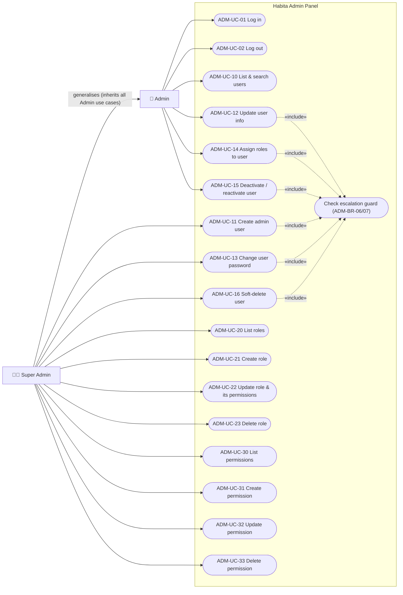

> Mermaid has no native UML use-case diagram. Stadium shapes are use cases, the arrow from Super Admin to Admin is actor generalisation, and dotted arrows are «include».

### A8.2 Use case specifications

Each spec lists only what is particular to it. Common preconditions for ADM-UC-10 to ADM-UC-33 are: the actor is logged in, active, and holds `admin-panel.access`.

| UC | Name | Actor permission | Main flow | Alternate / exception flows | FRs |
|---|---|---|---|---|---|
| ADM-UC-01 | Log in | `admin-panel.access` | 1. Visitor opens `/admin/login`. 2. Enters email and password, then submits. 3. System validates credentials, status and access. 4. System returns a token. 5. SPA stores the token and redirects to `/admin/users`. | 3a. Wrong credentials or soft-deleted user → "These credentials do not match our records." 3b. Deactivated → "Your account has been deactivated." 3c. No `admin-panel.access` → "You do not have access to the admin panel." 3d. Throttled → "Too many login attempts. Please try again in :seconds seconds." 1a. Already logged in → redirect to `/admin/users`. | ADM-FR-AUTH-01..04, ADM-FR-UI-01 |
| ADM-UC-02 | Log out | (logged in) | 1. Actor clicks "Log out". 2. System blacklists the token. 3. SPA clears the token and goes to `/admin/login`. | 2a. API call fails (network or expired) → SPA still clears the token locally and redirects. | ADM-FR-AUTH-06 |
| ADM-UC-10 | List & search users | `users.view` | 1. Actor opens Users. 2. Sees a paginated table. 3. Optionally searches, filters by status or role, and pages through. | — | ADM-FR-USR-01, ADM-FR-USR-02 |
| ADM-UC-11 | Create admin user | `users.create` | 1. Clicks "New user". 2. Fills name, email, password and confirmation, and ticks ≥1 role (only assignable roles are enabled). 3. Saves. 4. Redirected to the Users list with toast "User created." | 3a. Validation errors are shown inline. 3b. A selected role is no longer assignable → 422 on `role_ids`. | ADM-FR-USR-03 |
| ADM-UC-12 | Update user info | `users.update` + ADM-BR-07 | 1. Opens the user's edit page. 2. Edits name or email. 3. Saves → toast "User updated." | 3a. Validation errors. 1a. Target not manageable → the section is read-only and the API returns 403. | ADM-FR-USR-04 |
| ADM-UC-13 | Change user password | `users.change-password` + ADM-BR-07, not self | 1. On the edit page clicks "Change password". 2. Enters the new password twice. 3. Saves → toast "Password changed." | 3a. Validation errors. Hidden for self. | ADM-FR-USR-05 |
| ADM-UC-14 | Assign roles to user | `users.assign-roles` + ADM-BR-07/08, not self | 1. On the edit page, Roles section, ticks or unticks roles (non-assignable roles are disabled, with a tooltip). 2. Saves → toast "Roles updated." | 2a. Empty selection is allowed only if the user is no longer to be an admin. Confirm first: "This user will lose access to the admin panel. Continue?" if the new set lacks `admin-panel.access`. | ADM-FR-USR-06 |
| ADM-UC-15 | Deactivate / reactivate | `users.change-status` + ADM-BR-07, not self | 1. Clicks "Deactivate". 2. Confirms. 3. Toast "User deactivated." The status badge changes. Reactivate works the same way with "User reactivated." | 2a. Cancel → no change. | ADM-FR-USR-07, ADM-FR-USR-08 |
| ADM-UC-16 | Soft-delete user | `users.delete` + ADM-BR-07, not self | 1. Clicks "Delete user". 2. Confirms by typing the user's email. 3. Redirected to the list with toast "User deleted." | 2a. Cancel → no change. | ADM-FR-USR-09 |
| ADM-UC-20 | List roles | `roles.view` | Paginated table with search. | — | ADM-FR-ROL-01 |
| ADM-UC-21 | Create role | `roles.create` | 1. "New role". 2. Name, display name, description, and a permission checklist grouped by prefix. 3. Save → "Role created." | Validation errors. | ADM-FR-ROL-03 |
| ADM-UC-22 | Update role | `roles.update` | Same form, prefilled. Save → "Role updated." | Validation errors. | ADM-FR-ROL-04 |
| ADM-UC-23 | Delete role | `roles.delete` | 1. "Delete". 2. Dialog: "Delete role ‘:display_name’? It will be removed from :count user(s)." 3. Confirm → "Role deleted." | Cancel. | ADM-FR-ROL-05 |
| ADM-UC-30 | List permissions | `permissions.view` | Paginated table with search. | — | ADM-FR-PRM-01 |
| ADM-UC-31 | Create permission | `permissions.create` | Form: name, display name, description → "Permission created." | Validation errors. | ADM-FR-PRM-03 |
| ADM-UC-32 | Update permission | `permissions.update` | Same form, prefilled → "Permission updated." | Validation errors. | ADM-FR-PRM-04 |
| ADM-UC-33 | Delete permission | `permissions.delete` | Dialog: "Delete permission ‘:display_name’? It will be removed from :count role(s)." → "Permission deleted." | Cancel. | ADM-FR-PRM-05 |

## A9. Activity diagrams

### A9.1 Login (ADM-UC-01)

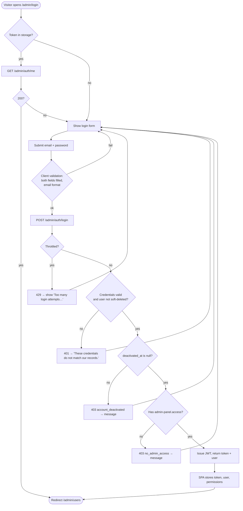

### A9.2 Assign roles to a user (ADM-UC-14)

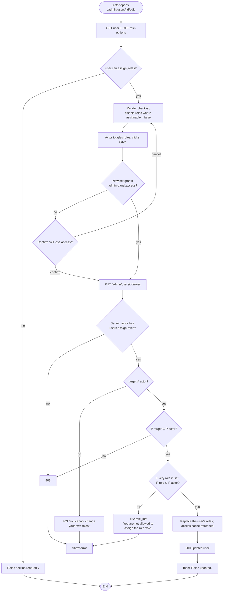

### A9.3 Delete a role (ADM-UC-23)

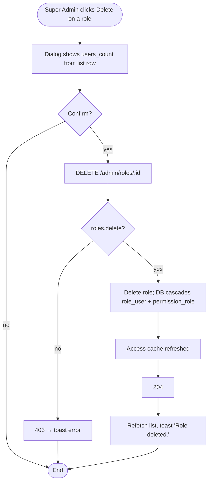

### A9.4 Screen navigation map

Where each click leads. Edge labels are IX IDs from §A12.7. Hexagons are dialogs, which keep the underlying screen mounted. The same map is drawn, with the controls that trigger each move, as the ADM-S-00 flow map in the Figma section "Admin (ADM)" (§G1.1).

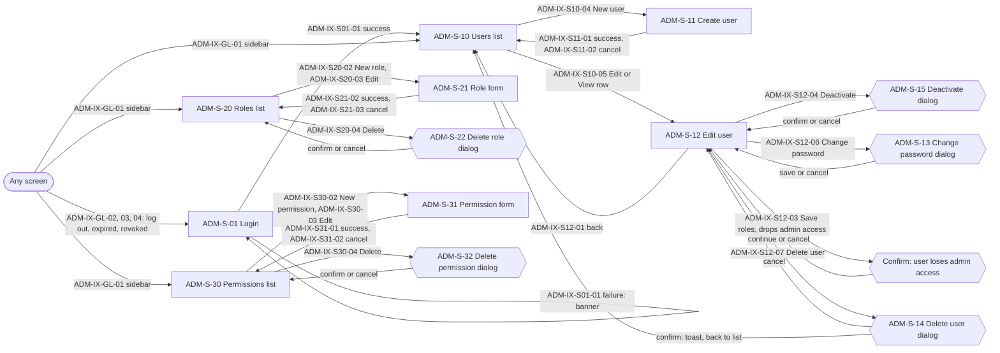

## A10. Sequence diagrams

### A10.1 Login

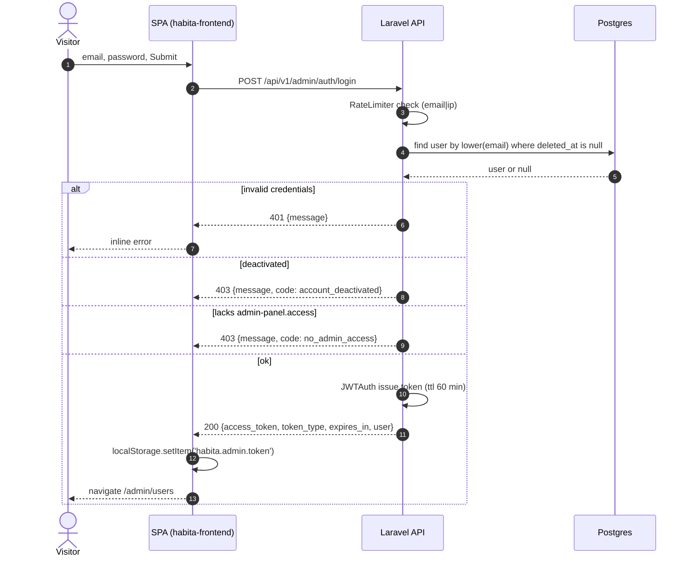

### A10.2 Authorised request with silent refresh

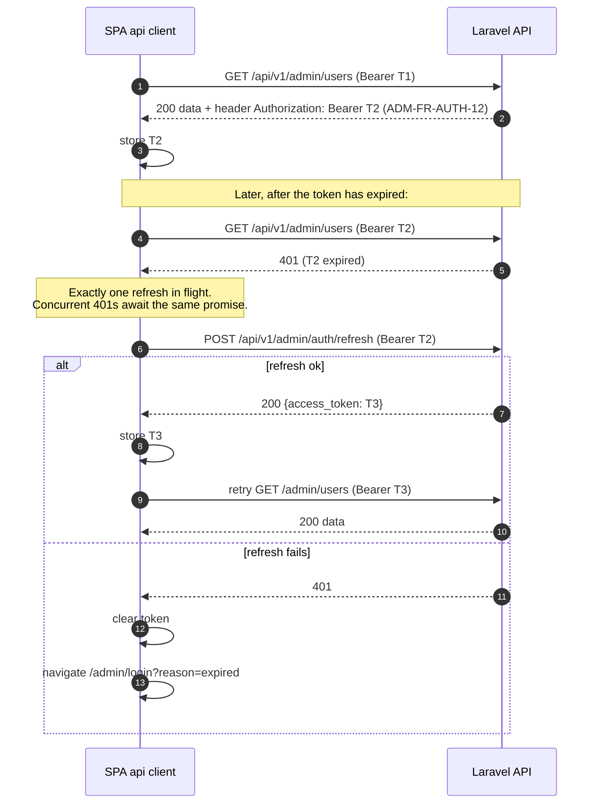

### A10.3 Checks on every `/api/v1/admin/*` call (except login)

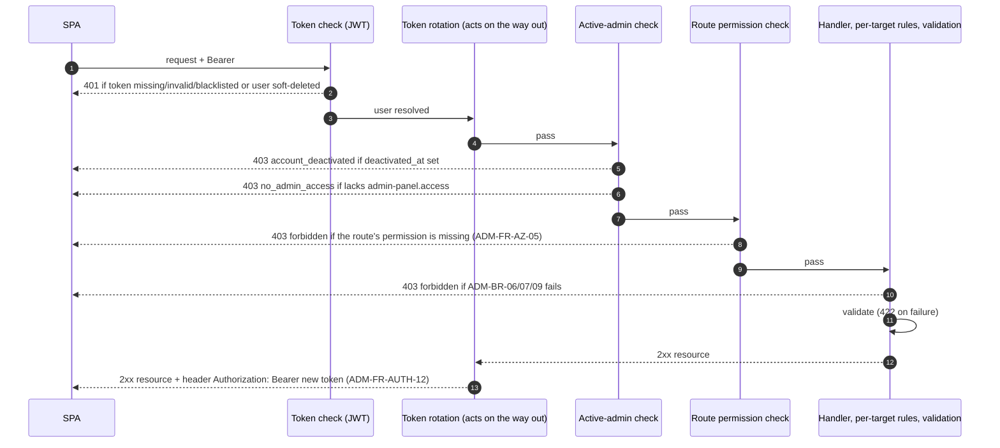

## A11. State diagram — user lifecycle

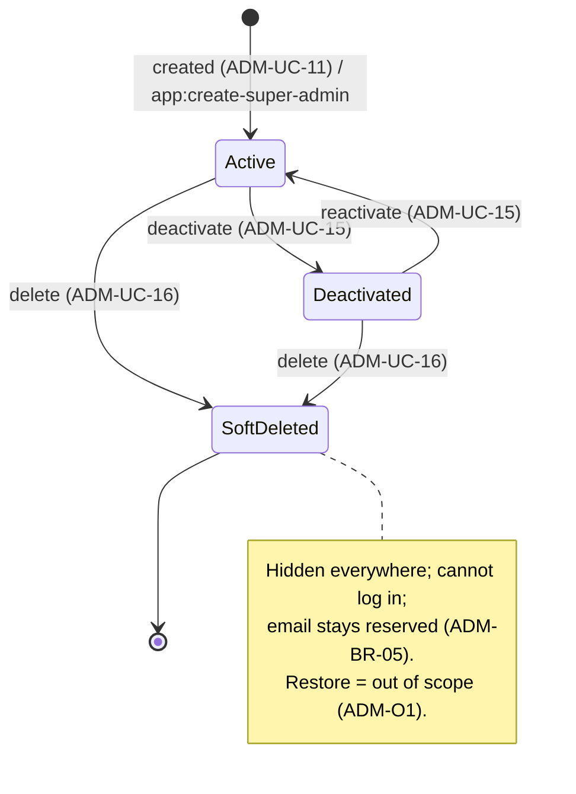

## A12. Functional requirements

Each FR is atomic and has acceptance criteria in §A15.

### A12.1 Authentication (backend + frontend)

| ID | Requirement |
|---|---|
| ADM-FR-AUTH-01 | `POST /api/v1/admin/auth/login` accepts `email` and `password`. On success it returns a JWT, `token_type: "bearer"`, `expires_in` (seconds), and the `AuthUser` resource. |
| ADM-FR-AUTH-02 | Login rejects wrong credentials and soft-deleted users with **401** and the generic message (it doesn't reveal whether the email exists). |
| ADM-FR-AUTH-03 | Login rejects deactivated users (403 `account_deactivated`) and users without `admin-panel.access` (403 `no_admin_access`). These checks run **only after** the password is verified. |
| ADM-FR-AUTH-04 | Login is rate-limited per ADM-BR-20. Successful login clears the limiter key. |
| ADM-FR-AUTH-05 | `GET /api/v1/admin/auth/me` returns the `AuthUser` for the current token. |
| ADM-FR-AUTH-06 | `POST /api/v1/admin/auth/logout` blacklists the current token **immediately (no grace period)** and returns 204. |
| ADM-FR-AUTH-07 | `POST /api/v1/admin/auth/refresh` returns a new token (same shape as login) and blacklists the old one. It works for up to `JWT_REFRESH_TTL` after the token was issued. The old token keeps working for the blacklist grace period (ADM-NFR-01), then gets 401. |
| ADM-FR-AUTH-08 | An active-admin check applies to all `/api/v1/admin/*` routes except `auth/login` and `auth/refresh`. It enforces ADM-BR-01 and ADM-BR-03 with the codes in §A13.2. |
| ADM-FR-AUTH-09 | SPA stores the token in `localStorage` under `habita.admin.token` and sends it as `Authorization: Bearer`. |
| ADM-FR-AUTH-10 | SPA silent-refresh: on a 401 from any call other than login or refresh, the client refreshes once (single-flight) and retries. If that fails, it clears the token and redirects to `/admin/login?reason=expired`. The login page then shows "Your session has expired. Please log in again." |
| ADM-FR-AUTH-11 | SPA: on any 403 with `code` `account_deactivated` or `no_admin_access`, it clears the token and redirects to `/admin/login`, showing the API's message. |
| ADM-FR-AUTH-12 | **Token rotation.** After every 2xx response from an authenticated `/api/v1/admin/*` route other than `auth/logout`, the API refreshes the request's token and returns the new one in the response header `Authorization: Bearer <token>`. The old token keeps working for the blacklist grace period, so requests already in flight don't fail. Rotation doesn't extend a session past `JWT_REFRESH_TTL` from login: once the token can't be refreshed any more, the response carries no new token and the current token runs to its expiry. Login and refresh return their token in the body and don't set the header. Non-2xx responses don't rotate. |
| ADM-FR-AUTH-13 | SPA: whenever a response carries `Authorization: Bearer <token>`, the client stores that token (replacing the old one) before it handles the body. |

### A12.2 Authorisation core (backend)

| ID | Requirement |
|---|---|
| ADM-FR-AZ-01 | The backend decides, for each actor, (a) which roles the actor may assign (ADM-BR-06), (b) which users the actor may manage (ADM-BR-07; always true for self) and (c) the effective permissions of any user or role. The same decisions drive the API checks and the `assignable` and `can` flags the API returns. |
| ADM-FR-AZ-02 | Each user action (list, view, create, update, change password, assign roles, change status, delete) requires its permission from §A7.2 and, for actions on a target, that the target is manageable (ADM-BR-07). Change password, assign roles, change status and delete also deny when actor = target (ADM-BR-09, ADM-BR-12). |
| ADM-FR-AZ-03 | Each role action and each permission action (list, view, create, update, delete) requires the matching permission from §A7.2. |
| ADM-FR-AZ-04 | The user resource exposes `can: {update, change_password, assign_roles, change_status, delete}`, computed for the current actor from the ADM-FR-AZ-02 rules. The SPA uses these flags only to show or hide controls. The server always re-checks. |
| ADM-FR-AZ-05 | Every route #5–#25 is guarded by a route-level permission check (Laratrust) for the permission listed in §A13.1. A missing permission returns 403 `{"message":"This action is unauthorized.","code":"forbidden"}` before the request is handled. The per-target rules still apply. |

### A12.3 Users

| ID | Requirement |
|---|---|
| ADM-FR-USR-01 | `GET /admin/users` is paginated (15 per page), ordered by `created_at desc, id desc`, and excludes soft-deleted users. Each row includes its roles (eager-loaded, no N+1). |
| ADM-FR-USR-02 | Filters, combinable: `search` (case-insensitive substring on name OR email), `status` (`active`\|`deactivated`), `role_id` (users having that role). Invalid filter values → 422. |
| ADM-FR-USR-03 | `POST /admin/users` creates a user with `name, email, password, password_confirmation, role_ids[]` (≥1, each assignable). The response is 201 with `UserResource`. The new user is active. |
| ADM-FR-USR-04 | `PUT /admin/users/{id}` updates `name, email`. Email is unique, ignoring the target itself. |
| ADM-FR-USR-05 | `PUT /admin/users/{id}/password` sets `password` (+ `password_confirmation`) and returns 204. |
| ADM-FR-USR-06 | `PUT /admin/users/{id}/roles` syncs `role_ids[]` (may be empty) per ADM-BR-08 and returns the user resource. |
| ADM-FR-USR-07 | `POST /admin/users/{id}/deactivate` sets `deactivated_at = now()`. If already deactivated it is idempotent and returns 200 with the unchanged timestamp. |
| ADM-FR-USR-08 | `POST /admin/users/{id}/activate` sets `deactivated_at = null`. Idempotent. Returns 200. |
| ADM-FR-USR-09 | `DELETE /admin/users/{id}` soft-deletes and returns 204. Afterwards `GET /admin/users/{id}` returns 404. |
| ADM-FR-USR-10 | `GET /admin/users/{id}` returns `UserResource`. 404 for missing or soft-deleted users. |
| ADM-FR-USR-11 | `GET /admin/role-options` (requires `users.view`) returns **all** roles ordered by `display_name`, each with `assignable: bool` per ADM-BR-06 for the actor and `grants_admin_access: bool` (the role's permissions include `admin-panel.access`; the SPA uses it for the ADM-UC-14 2a confirmation). It is not paginated. |

### A12.4 Roles

| ID | Requirement |
|---|---|
| ADM-FR-ROL-01 | `GET /admin/roles` is paginated (15), ordered by `name asc`, with `search` on name or display_name. Each row has `permissions_count` and `users_count` (via `withCount`). |
| ADM-FR-ROL-02 | `GET /admin/roles/{id}` returns the role and its `permissions[]`. |
| ADM-FR-ROL-03 | `POST /admin/roles` takes `name, display_name, description, permission_ids[]` (may be empty). Returns 201. |
| ADM-FR-ROL-04 | `PUT /admin/roles/{id}` takes the same body and fully replaces fields and permissions (sync). Refreshes the access cache (ADM-NFR-06). |
| ADM-FR-ROL-05 | `DELETE /admin/roles/{id}` → 204. DB cascade per ADM-BR-14. Refreshes the access cache (ADM-NFR-06). |
| ADM-FR-ROL-06 | `GET /admin/permission-options` (requires `roles.create` OR `roles.update`) returns all permissions ordered by `name`, as `{id, name, display_name, group}`, where `group` is the substring before the first `.` (or `"other"` if there is no dot). |

### A12.5 Permissions

| ID | Requirement |
|---|---|
| ADM-FR-PRM-01 | `GET /admin/permissions` is paginated (15), ordered by `name asc`, with `search` on name or display_name. Each row has `roles_count`. |
| ADM-FR-PRM-02 | `GET /admin/permissions/{id}` returns the permission. |
| ADM-FR-PRM-03 | `POST /admin/permissions` takes `name, display_name, description`. Returns 201. |
| ADM-FR-PRM-04 | `PUT /admin/permissions/{id}` takes the same body. |
| ADM-FR-PRM-05 | `DELETE /admin/permissions/{id}` → 204. DB cascade per ADM-BR-15. Refreshes the access cache (ADM-NFR-06). |

### A12.6 Frontend UI

The screens are drawn as low-fidelity wireframes in the Figma section "Admin (ADM)" (§G1.1). Each screen or dialog is one frame, named with its screen ID and title, for example `ADM-S-10 Users list`. The wireframes show layout and content only. Visual styling (colours, type) is not specified.

The states the frames must cover: ADM-S-01 with no banner, an error banner and the session-expired banner; ADM-S-10 as a Super Admin and as an Admin; ADM-S-12 for four actor/target pairs (Super Admin viewing an Admin, Admin viewing an Admin, Admin viewing a Super Admin, self) and for a deactivated target; ADM-S-20 and ADM-S-21 for create and edit; ADM-S-99 for 403, 404, empty states and toasts.

**How the wireframes show behaviour** (the owner asked for this; it applies to every screen):
- **Flow map (ADM-S-00).** The first board of the section draws every screen as a card, with an arrow for every navigation. Each arrow is labelled with the control that triggers it. Dialogs hang off the screen that opens them.
- **Numbered controls.** Every control that does something carries a small numbered badge. The number is the last part of the control's IX ID (badge 5 on ADM-S-10 is ADM-IX-S10-05).
- **Interactions panel.** Each screen ends with an "Interactions" panel listing its badges: trigger, request, result and destination. The panels show the success path. The panel and §A12.7 hold the failure paths.
- **Source of truth.** The IX tables in §A12.7 are normative. If a wireframe panel and §A12.7 disagree, §A12.7 wins and the wireframe is a bug.

| ID | Screen / behaviour | Route |
|---|---|---|
| ADM-FR-UI-01 | **ADM-S-01 Login**: email, password, "Log in" button (disabled + spinner while submitting), error banner, `?reason=expired` banner. | `/admin/login` |
| ADM-FR-UI-02 | **Layout**: left sidebar showing only the sections the actor may view (Users if `users.view`, Roles if `roles.view`, Permissions if `permissions.view`). Top bar shows the actor's name and a "Log out" button. | all `/admin/*` |
| ADM-FR-UI-03 | **Route guard**: an unauthenticated user goes to `/admin/login`. Lacking a page's permission shows **ADM-S-99 "403: You don't have permission to view this page."** with a link back. `/admin` redirects to the first section the actor can view. Unknown `/admin/*` shows "404: Page not found". |
| ADM-FR-UI-04 | **ADM-S-10 Users list**: columns Name, Email, Roles (display names as chips), Status badge (Active / Deactivated), Created (YYYY-MM-DD), and a row action "Edit" if `can.update \|\| can.assign_roles \|\| can.change_status \|\| can.change_password \|\| can.delete`, otherwise "View". Toolbar: search (debounced 300 ms), Status select (All / Active / Deactivated), Role select (All + role-options), and a "New user" button if the actor has `users.create`. Pagination: "Showing x–y of z" plus Prev/Next. Empty state: "No users match your filters." Filters are reflected in the URL query string. | `/admin/users` |
| ADM-FR-UI-05 | **ADM-S-11 Create user**: Name, Email, Password, Confirm password, Roles checklist (disabled + tooltip "You can't assign this role" when not assignable), Cancel and "Create user". | `/admin/users/new` |
| ADM-FR-UI-06 | **ADM-S-12 Edit user**: header with the user's name and email, then cards, each with its own Save. (a) **Details**, always shown: name and email inputs + "Save details" if `can.update`, otherwise a read-only list. (b) **Roles**, always shown: a checklist of all role-options + "Save roles" if `can.assign_roles` (options with `assignable = false` are disabled with the tooltip "You can't assign this role"), otherwise read-only role chips. (c) **Status**, always shown: badge, plus a "Deactivate" / "Reactivate" button only if `can.change_status`. (d) **Danger zone**, shown only if `can.change_password \|\| can.delete`: "Change password" (opens ADM-S-13) if `can.change_password`, and "Delete user" (opens ADM-S-14) if `can.delete`. When viewing self, show the note "This is your account. Some actions are unavailable." above the cards. | `/admin/users/:id/edit` |
| ADM-FR-UI-07 | **ADM-S-13 Change password dialog**: New password, Confirm, policy hint "At least 12 characters with upper- and lower-case letters and a number.", Cancel, "Change password". | dialog |
| ADM-FR-UI-08 | **ADM-S-14 Delete user dialog**: the text "This will delete :name. They will no longer be able to log in. Type their email to confirm." The confirm button stays disabled until the typed value equals the email. | dialog |
| ADM-FR-UI-09 | **ADM-S-15 Deactivate dialog**: "Deactivate :name? They will be logged out and unable to log in until reactivated." Reactivating needs no confirmation. | dialog |
| ADM-FR-UI-10 | **ADM-S-20 Roles list**: columns Display name, Name (monospace), Permissions (count), Users (count), and actions Edit (if `roles.update`) and Delete (if `roles.delete`). "New role" button if `roles.create`. Search and pagination as in ADM-FR-UI-04. | `/admin/roles` |
| ADM-FR-UI-11 | **ADM-S-21 Role form** (create and edit): Name, Display name, Description, and a permission checklist grouped by `group`. The group heading replaces hyphens with spaces and uses Title Case (`admin-panel` becomes "Admin Panel"). Groups are ordered alphabetically by heading, with "Other" last. Each group has a "Select all" toggle, which is checked when every item is checked. Save label: "Create role" / "Save changes". | `/admin/roles/new`, `/admin/roles/:id/edit` |
| ADM-FR-UI-12 | **ADM-S-22 Delete role dialog**: text per ADM-UC-23. | dialog |
| ADM-FR-UI-13 | **ADM-S-30 Permissions list**: columns Display name, Name, Description, Roles (count), and actions as in ADM-FR-UI-10. | `/admin/permissions` |
| ADM-FR-UI-14 | **ADM-S-31 Permission form** (create and edit): Name, Display name, Description. | `/admin/permissions/new`, `/admin/permissions/:id/edit` |
| ADM-FR-UI-15 | **ADM-S-32 Delete permission dialog**: text per ADM-UC-33. | dialog |
| ADM-FR-UI-16 | **Feedback**: success toasts (§A14), top-right, auto-dismiss after 4 s, with a "Dismiss" (×) button. While a list loads it shows 5 skeleton rows. Server 422 errors map to the field under the input. Other errors show a toast: "Something went wrong. Please try again." Forms disable the submit button while a request is in flight. |
| ADM-FR-UI-17 | After a successful mutation, the affected list or detail is refetched. If the actor changed their **own** name or email, the top-bar name updates (refetch `/auth/me`). |
| ADM-FR-UI-18 | **Interactions are specified per control.** Every control that does something has an IX row in §A12.7 giving its trigger, request, success result (including the destination screen) and failure result. A control with no IX row is a gap. |
| ADM-FR-UI-19 | **Navigation behaviour.** Navigating between screens pushes a browser history entry. List screens keep their filters and page in the URL query string and restore them when the user returns to the list with a Back or Cancel link or after a delete (ADM-D-11). Leaving a form with unsaved edits does not prompt; the edits are discarded (ADM-D-10). |
| ADM-FR-UI-20 | **Dialogs.** Cancel and Esc close a dialog without sending a request. While a dialog's request is pending its confirm button is disabled. When a dialog closes, focus returns to the button that opened it. |

### A12.7 Screen interactions (IX)

Normative behaviour of every control. Failure column conventions: **422** shows the server's messages under the matching fields and keeps the user on the screen with their input; **other errors** show the toast "Something went wrong. Please try again." and change nothing else. Global 401 and 403 handling is ADM-IX-GL-03 and ADM-IX-GL-04 and is not repeated per screen.

**Global (every `/admin/*` screen)**

| IX | Control | Shown when | Trigger | Request | On success | On failure |
|---|---|---|---|---|---|---|
| ADM-IX-GL-01 | Sidebar link: Users, Roles or Permissions | per ADM-FR-UI-02 | click | none | navigate to ADM-S-10, ADM-S-20 or ADM-S-30; no confirmation (ADM-D-10); the current link has `aria-current="page"` | — |
| ADM-IX-GL-02 | "Log out" in the top bar | always | click | `POST /admin/auth/logout` | clear the token, navigate to ADM-S-01 with no banner | clear the token and navigate to ADM-S-01 anyway |
| ADM-IX-GL-03 | Session expiry | automatic | any API call returns 401 (except login and refresh) | `POST /admin/auth/refresh` once, then retry the call (ADM-FR-AUTH-10) | the original action completes unnoticed | clear the token, navigate to ADM-S-01 at `?reason=expired`, which shows "Your session has expired. Please log in again." |
| ADM-IX-GL-04 | Access revoked | automatic | any API call returns 403 with `code` `account_deactivated` or `no_admin_access` | none | — | clear the token, navigate to ADM-S-01 showing the response's `message` in the error banner |
| ADM-IX-GL-05 | Route the actor may not open, or unknown route | automatic | navigation | none | ADM-S-99 shows "You don't have permission to view this page." or "Page not found." | — |

**ADM-S-01 Login**

| IX | Control | Shown when | Trigger | Request | On success | On failure |
|---|---|---|---|---|---|---|
| ADM-IX-S01-01 | "Log in" button, or Enter in either field | always | click or submit, after the client checks both fields are filled and the email is well formed | `POST /admin/auth/login`; the button is disabled with a spinner while pending | store the token and user, navigate to `/admin`, which redirects to the first section the actor may view (ADM-S-10) | 401: banner "These credentials do not match our records.", password field cleared, stay · 403: banner with the response's `message`, stay · 429: banner "Too many login attempts. Please try again in :seconds seconds.", stay · other: generic toast |
| ADM-IX-S01-02 | (page load) | a token is stored | automatic | `GET /admin/auth/me` | 200: navigate to `/admin` without showing the form | any other status: clear the token and show the form |

**ADM-S-10 Users list**

| IX | Control | Shown when | Trigger | Request | On success | On failure |
|---|---|---|---|---|---|---|
| ADM-IX-S10-01 | Search input | always | typing, 300 ms after the last keystroke | `GET /admin/users?search=` with page reset to 1 | the URL query updates and the table refetches in place; stay on ADM-S-10 | generic toast; the table keeps its rows |
| ADM-IX-S10-02 | Status select | always | change | `GET /admin/users?status=` with page reset to 1 | as ADM-IX-S10-01 | as ADM-IX-S10-01 |
| ADM-IX-S10-03 | Role select | always | change | `GET /admin/users?role_id=` with page reset to 1. Options come from `GET /admin/role-options` on page load | as ADM-IX-S10-01 | as ADM-IX-S10-01 |
| ADM-IX-S10-04 | "New user" button | `users.create` | click | none | navigate to ADM-S-11 `/admin/users/new` | — |
| ADM-IX-S10-05 | Row link "Edit" or "View" (label per ADM-FR-UI-04) | always | click | none on ADM-S-10. ADM-S-12 then loads `GET /admin/users/:id` and `GET /admin/role-options` and shows skeleton cards until both return | navigate to ADM-S-12 `/admin/users/:id/edit`, pushing a history entry so browser Back returns to ADM-S-10 with its query string | on ADM-S-12: 404 shows ADM-S-99 "Page not found."; other errors show the generic toast |
| ADM-IX-S10-06 | Prev and Next | more than one page | click | `GET /admin/users?page=` | the URL query updates and the table refetches. Prev is disabled on page 1 and Next on the last page | generic toast |

**ADM-S-11 Create user**

| IX | Control | Shown when | Trigger | Request | On success | On failure |
|---|---|---|---|---|---|---|
| ADM-IX-S11-01 | "Create user" button | always (the route needs `users.create`) | click or submit | `POST /admin/users`; the button is disabled while pending | navigate to ADM-S-10 `/admin/users` with no filters, so the newest user shows first, and toast "User created." | 422 (`role_ids` errors appear under the Roles list), otherwise generic toast |
| ADM-IX-S11-02 | "Cancel" and "← Back to users" | always | click | none | navigate to ADM-S-10 with its previous query string (ADM-D-11); entered data is discarded without a prompt (ADM-D-10) | — |

**ADM-S-12 Edit user**

| IX | Control | Shown when | Trigger | Request | On success | On failure |
|---|---|---|---|---|---|---|
| ADM-IX-S12-01 | "← Back to users" | always | click | none | navigate to ADM-S-10 with the query string it was opened from (ADM-D-11) | — |
| ADM-IX-S12-02 | "Save details" | `can.update` | click or submit | `PUT /admin/users/:id` | toast "User updated."; stay on ADM-S-12; if the target is the actor, refetch `/auth/me` so the top bar shows the new name (ADM-FR-UI-17) | 422, e.g. "This email is already in use."; otherwise generic toast |
| ADM-IX-S12-03 | "Save roles" | `can.assign_roles` | click | if the chosen set grants no `admin-panel.access`, first open the dialog "This user will lose access to the admin panel. Continue?" with Cancel and Continue (Cancel closes it, no request). Then `PUT /admin/users/:id/roles` | toast "Roles updated."; stay on ADM-S-12 | 422 on `role_ids.N`: the message appears under the checklist; otherwise generic toast |
| ADM-IX-S12-04 | "Deactivate" | `can.change_status` and the user is active | click | opens ADM-S-15 with no request. Its confirm button sends `POST /admin/users/:id/deactivate` | the dialog closes; the badge reads "Deactivated"; the button becomes "Reactivate"; toast "User deactivated." | the dialog stays open and the generic toast shows. Cancel or Esc closes it |
| ADM-IX-S12-05 | "Reactivate" | `can.change_status` and the user is deactivated | click | `POST /admin/users/:id/activate`, no dialog | the badge reads "Active"; the button becomes "Deactivate"; toast "User reactivated." | generic toast |
| ADM-IX-S12-06 | "Change password" | `can.change_password` | click | opens ADM-S-13 with no request. Its save button sends `PUT /admin/users/:id/password` | the dialog closes; toast "Password changed."; stay on ADM-S-12 | 422 shows inline in the dialog, which stays open. Cancel or Esc closes it |
| ADM-IX-S12-07 | "Delete user" | `can.delete` | click | opens ADM-S-14 with no request. Its confirm button is disabled until the typed text equals the user's email, then sends `DELETE /admin/users/:id` | navigate to ADM-S-10 with its previous query string (ADM-D-11) and toast "User deleted." | the dialog stays open and the generic toast shows. Cancel or Esc closes it |

**ADM-S-20 Roles list**

| IX | Control | Shown when | Trigger | Request | On success | On failure |
|---|---|---|---|---|---|---|
| ADM-IX-S20-01 | Search input | always | typing, 300 ms after the last keystroke | `GET /admin/roles?search=` with page reset to 1 | the URL query updates and the table refetches in place | generic toast |
| ADM-IX-S20-02 | "New role" button | `roles.create` | click | none. ADM-S-21 loads `GET /admin/permission-options` | navigate to ADM-S-21 `/admin/roles/new` | — |
| ADM-IX-S20-03 | Row link "Edit" | `roles.update` | click | none on ADM-S-20. ADM-S-21 loads `GET /admin/roles/:id` and `GET /admin/permission-options` | navigate to ADM-S-21 `/admin/roles/:id/edit` | on ADM-S-21: 404 shows ADM-S-99 "Page not found." |
| ADM-IX-S20-04 | Row link "Delete" | `roles.delete` | click | opens ADM-S-22 with the row's `users_count` in its text, no request. Its confirm button sends `DELETE /admin/roles/:id` | the dialog closes, the list refetches, toast "Role deleted."; stay on ADM-S-20 | the dialog stays open and the generic toast shows. Cancel or Esc closes it |
| ADM-IX-S20-05 | Prev and Next | more than one page | click | `GET /admin/roles?page=` | as ADM-IX-S10-06 | generic toast |

**ADM-S-21 Role form**

| IX | Control | Shown when | Trigger | Request | On success | On failure |
|---|---|---|---|---|---|---|
| ADM-IX-S21-01 | "Select all" in a permission group | always | toggle | none | ticks or unticks every permission in that group only. It reads as checked when every permission in the group is checked | — |
| ADM-IX-S21-02 | "Create role" or "Save changes" | always | click or submit | `POST /admin/roles` (create) or `PUT /admin/roles/:id` (edit) | navigate to ADM-S-20 and toast "Role created." or "Role updated." | 422, e.g. the name format message under Name |
| ADM-IX-S21-03 | "Cancel" and "← Back to roles" | always | click | none | navigate to ADM-S-20 with its previous query string (ADM-D-11); edits are discarded without a prompt (ADM-D-10) | — |

**ADM-S-30 Permissions list**

| IX | Control | Shown when | Trigger | Request | On success | On failure |
|---|---|---|---|---|---|---|
| ADM-IX-S30-01 | Search input | always | typing, 300 ms after the last keystroke | `GET /admin/permissions?search=` with page reset to 1 | the URL query updates and the table refetches in place | generic toast |
| ADM-IX-S30-02 | "New permission" button | `permissions.create` | click | none | navigate to ADM-S-31 `/admin/permissions/new` | — |
| ADM-IX-S30-03 | Row link "Edit" | `permissions.update` | click | none on ADM-S-30. ADM-S-31 loads `GET /admin/permissions/:id` | navigate to ADM-S-31 `/admin/permissions/:id/edit` | on ADM-S-31: 404 shows ADM-S-99 "Page not found." |
| ADM-IX-S30-04 | Row link "Delete" | `permissions.delete` | click | opens ADM-S-32 with the row's `roles_count` in its text, no request. Its confirm button sends `DELETE /admin/permissions/:id` | the dialog closes, the list refetches, toast "Permission deleted."; stay on ADM-S-30 | the dialog stays open and the generic toast shows. Cancel or Esc closes it |
| ADM-IX-S30-05 | Prev and Next | more than one page | click | `GET /admin/permissions?page=` | as ADM-IX-S10-06 | generic toast |

**ADM-S-31 Permission form**

| IX | Control | Shown when | Trigger | Request | On success | On failure |
|---|---|---|---|---|---|---|
| ADM-IX-S31-01 | "Create permission" or "Save changes" | always | click or submit | `POST /admin/permissions` (create) or `PUT /admin/permissions/:id` (edit) | navigate to ADM-S-30 and toast "Permission created." or "Permission updated." | 422, e.g. the name format message under Name |
| ADM-IX-S31-02 | "Cancel" and "← Back to permissions" | always | click | none | navigate to ADM-S-30 with its previous query string (ADM-D-11); edits are discarded without a prompt (ADM-D-10) | — |

**ADM-S-99 System states**

| IX | Control | Shown when | Trigger | Request | On success | On failure |
|---|---|---|---|---|---|---|
| ADM-IX-S99-01 | Toast "Dismiss" (×) | a toast is visible | click, or 4 s after it appeared | none | the toast closes | — |
| ADM-IX-S99-02 | "Back to admin home" on the 403 and 404 pages | always | click | none | navigate to `/admin`, which redirects to the first section the actor may view (ADM-FR-UI-03) | — |

## A13. API contract

Base URL: `${VITE_API_BASE_URL}/api/v1` (local Docker stack: `http://localhost:8000/api/v1`, §G7.2). Every request sends `Accept: application/json`. Every request except login sends `Authorization: Bearer <token>`. Responses use Laravel API Resources (`data` wrapper). Successful responses from authenticated admin routes (except logout) carry `Authorization: Bearer <new token>` (ADM-FR-AUTH-12).

### A13.1 Endpoints

| # | Method & path | Route permission (Laratrust) | Request body / query | Success |
|---|---|---|---|---|
| 1 | `POST /admin/auth/login` | — (throttled) | `{email, password}` | 200 `{access_token, token_type, expires_in, user: AuthUser}` |
| 2 | `POST /admin/auth/refresh` | valid or refreshable token | — | 200 same as #1 |
| 3 | `GET /admin/auth/me` | — (active admin) | — | 200 `{data: AuthUser}` |
| 4 | `POST /admin/auth/logout` | — (active admin) | — | 204 |
| 5 | `GET /admin/users` | `users.view` | `?search=&status=&role_id=&page=` | 200 paginated `UserResource` |
| 6 | `POST /admin/users` | `users.create` | `{name, email, password, password_confirmation, role_ids[]}` | 201 `{data: UserResource}` |
| 7 | `GET /admin/users/{user}` | `users.view` | — | 200 |
| 8 | `PUT /admin/users/{user}` | `users.update` | `{name, email}` | 200 |
| 9 | `PUT /admin/users/{user}/password` | `users.change-password` | `{password, password_confirmation}` | 204 |
| 10 | `PUT /admin/users/{user}/roles` | `users.assign-roles` | `{role_ids[]}` | 200 |
| 11 | `POST /admin/users/{user}/deactivate` | `users.change-status` | — | 200 |
| 12 | `POST /admin/users/{user}/activate` | `users.change-status` | — | 200 |
| 13 | `DELETE /admin/users/{user}` | `users.delete` | — | 204 |
| 14 | `GET /admin/role-options` | `users.view` | — | 200 `{data: RoleOption[]}` |
| 15 | `GET /admin/roles` | `roles.view` | `?search=&page=` | 200 paginated `RoleResource` |
| 16 | `POST /admin/roles` | `roles.create` | `{name, display_name, description, permission_ids[]}` | 201 |
| 17 | `GET /admin/roles/{role}` | `roles.view` | — | 200 (includes `permissions`) |
| 18 | `PUT /admin/roles/{role}` | `roles.update` | same as #16 | 200 |
| 19 | `DELETE /admin/roles/{role}` | `roles.delete` | — | 204 |
| 20 | `GET /admin/permission-options` | `roles.create\|roles.update` (either) | — | 200 `{data: PermissionOption[]}` |
| 21 | `GET /admin/permissions` | `permissions.view` | `?search=&page=` | 200 paginated |
| 22 | `POST /admin/permissions` | `permissions.create` | `{name, display_name, description}` | 201 |
| 23 | `GET /admin/permissions/{permission}` | `permissions.view` | — | 200 |
| 24 | `PUT /admin/permissions/{permission}` | `permissions.update` | same as #22 | 200 |
| 25 | `DELETE /admin/permissions/{permission}` | `permissions.delete` | — | 204 |

Soft-deleted users are never found, so `{user}` routes return 404 for them. Routes with a target user, role or permission also apply the per-target rules (BR-06, BR-07, BR-09) after the route permission check.

### A13.2 Error responses

| Status | When | Body |
|---|---|---|
| 401 | Missing, invalid, expired or blacklisted token, or the user no longer exists | `{"message": "Unauthenticated."}` |
| 401 | Login failure | `{"message": "These credentials do not match our records."}` |
| 403 | Deactivated | `{"message": "Your account has been deactivated.", "code": "account_deactivated"}` |
| 403 | Lacks `admin-panel.access` | `{"message": "You do not have access to the admin panel.", "code": "no_admin_access"}` |
| 403 | Permission or per-target rule denial | `{"message": "This action is unauthorized.", "code": "forbidden"}` |
| 404 | Missing model | `{"message": "Not found."}` |
| 422 | Validation | Laravel default `{"message", "errors": {field: [msg]}}` |
| 429 | Throttled login | `{"message": "Too many login attempts. Please try again in N seconds."}` |

### A13.3 Resource shapes

```jsonc
// AuthUser
{ "id": 1, "name": "Jane", "email": "jane@habita.app",
  "roles": [{ "id": 1, "name": "super-admin", "display_name": "Super Admin" }],
  "permissions": ["admin-panel.access", "users.view", "..."] }   // sorted asc

// UserResource
{ "id": 7, "name": "Sam", "email": "sam@habita.app",
  "status": "active",                 // "active" | "deactivated"
  "deactivated_at": null,             // ISO-8601 string | null
  "created_at": "2026-10-25T10:00:00Z", "updated_at": "…",
  "roles": [{ "id": 2, "name": "admin", "display_name": "Admin" }],
  "can": { "update": true, "change_password": false, "assign_roles": true,
           "change_status": true, "delete": false } }

// RoleResource (list rows add permissions_count, users_count; show adds permissions[])
{ "id": 2, "name": "admin", "display_name": "Admin", "description": "Manages users",
  "permissions_count": 5, "users_count": 3,
  "permissions": [{ "id": 1, "name": "users.view", "display_name": "View users" }],
  "created_at": "…", "updated_at": "…" }

// PermissionResource (list rows add roles_count)
{ "id": 1, "name": "users.view", "display_name": "View users",
  "description": "List and view users", "roles_count": 2, "created_at": "…", "updated_at": "…" }

// RoleOption       { "id": 2, "name": "admin", "display_name": "Admin", "assignable": true, "grants_admin_access": true }
// PermissionOption { "id": 1, "name": "users.view", "display_name": "View users", "group": "users" }

// Paginated list (Laravel default)
{ "data": [ … ], "links": { … }, "meta": { "current_page": 1, "last_page": 3, "per_page": 15, "total": 41, "from": 1, "to": 15 } }
```

### A13.4 Validation rules

| Field | Rules | Custom message (where the default isn't used) |
|---|---|---|
| user.name | required, string, max:255 | — |
| user.email | required, string, trimmed and lower-cased, valid email, max:255, unique:users,email (ignore self on update; includes soft-deleted) | unique → "This email is already in use." |
| user.password | required, string, confirmed, password policy (`SH-03`) | — |
| user.role_ids | create: required, array, min:1. Roles endpoint: present, array. | min → "Select at least one role." |
| user.role_ids.* | integer, distinct, exists:roles,id, assignable (ADM-BR-06) | "You are not allowed to assign the role :role." |
| search | nullable, string, max:100 | — |
| status | nullable, in:active,deactivated | — |
| role_id | nullable, integer, exists:roles,id | — |
| role.name | required, string, max:255, regex `^[a-z0-9]+(-[a-z0-9]+)*$`, unique:roles,name (ignore self) | regex → "Use lower-case letters, numbers and single hyphens (e.g. content-editor)." |
| role.display_name | required, string, max:255 | — |
| role.description | nullable, string, max:255 | — |
| role.permission_ids | present, array | — |
| role.permission_ids.* | integer, distinct, exists:permissions,id | — |
| permission.name | required, string, max:255, regex `^[a-z0-9]+(-[a-z0-9]+)*(\.[a-z0-9]+(-[a-z0-9]+)*)*$`, unique:permissions,name (ignore self) | regex → "Use lower-case words separated by dots or hyphens (e.g. habits.view)." |
| permission.display_name | required, string, max:255 | — |
| permission.description | nullable, string, max:255 | — |

Self-action denials return 403 with a specific message: "You cannot change your own roles.", "You cannot deactivate your own account.", "You cannot delete your own account.", "You cannot change your own password here."

## A14. UI copy catalogue

| Key | Text |
|---|---|
| toast.user.created / updated / deleted | "User created." / "User updated." / "User deleted." |
| toast.user.password | "Password changed." |
| toast.user.roles | "Roles updated." |
| toast.user.deactivated / reactivated | "User deactivated." / "User reactivated." |
| toast.role.created / updated / deleted | "Role created." / "Role updated." / "Role deleted." |
| toast.permission.created / updated / deleted | "Permission created." / "Permission updated." / "Permission deleted." |
| toast.error.generic | "Something went wrong. Please try again." |
| login.expired | "Your session has expired. Please log in again." |
| roles.lose-access | "This user will lose access to the admin panel. Continue?" |
| page.403 / page.404 | "You don't have permission to view this page." / "Page not found." |
| empty.users / roles / permissions | "No users match your filters." / "No roles found." / "No permissions found." |

## A15. Acceptance criteria (Given / When / Then)

Every AC became at least one automated test: API feature tests for API behaviour, and component tests for UI behaviour.

### Auth
- **ADM-AC-AUTH-01**: Given an active user with role `admin`, when they POST valid credentials to login, then the response is 200 and contains `access_token`, `token_type = "bearer"`, `expires_in = 3600`, and `user.permissions` includes `admin-panel.access`.
- **ADM-AC-AUTH-02**: Given a wrong password, OR a non-existent email, OR a soft-deleted user with the correct password, when they log in, then it returns 401 with "These credentials do not match our records."
- **ADM-AC-AUTH-03**: Given a deactivated admin with the correct password, then it returns 403 `account_deactivated`. Given an active user with no roles and the correct password, then it returns 403 `no_admin_access`.
- **ADM-AC-AUTH-04**: Given 5 failed attempts within a minute for the same email + IP, then the 6th attempt returns 429, even with the correct password.
- **ADM-AC-AUTH-05**: Given a valid token, when GET `/auth/me`, then it returns 200 `AuthUser`. When POST `/auth/logout`, then it returns 204 and the same token then gets 401 on `/auth/me`.
- **ADM-AC-AUTH-06**: Given a valid token, when POST `/auth/refresh`, then a new token is returned. The old token still works within the grace period and gets 401 after it.
- **ADM-AC-AUTH-07**: Given an admin whose token was issued and who is then deactivated, when they call any admin endpoint, then it returns 403 `account_deactivated`.
- **ADM-AC-AUTH-08**: Given an admin whose token was issued and who is then soft-deleted, when they call any admin endpoint, then it returns 401.
- **ADM-AC-AUTH-09**: Given an admin whose `admin` role is removed after login, when they call any admin endpoint, then it returns 403 `no_admin_access` (ADM-BR-19).
- **ADM-AC-AUTH-10 (UI)**: Given the login page, when submitting returns 401, then the banner shows the API message and the password field is cleared. Given `?reason=expired`, then "Your session has expired. Please log in again." is shown.
- **ADM-AC-AUTH-11 (UI)**: Given a stored token that the API rejects with 401 and refresh also fails, when any page loads data, then the token is removed from localStorage and the browser is at `/admin/login?reason=expired`.
- **ADM-AC-AUTH-12 (UI)**: Given two requests that both get 401, then only **one** refresh call is made, and both are retried with the new token.
- **ADM-AC-AUTH-13**: Given a valid token T1, when GET `/auth/me`, then it's 200 with header `Authorization: Bearer T2`, T2 ≠ T1, and T2 works. T1 still works within 30 s and gets 401 after. A 403 or 422 response has no `Authorization` header. Login, refresh and logout responses have none. More than 24 h after login, a 2xx response has no new token.
- **ADM-AC-AUTH-14 (UI)**: Given a response with header `Authorization: Bearer T2`, then `habita.admin.token` holds T2 and the next request sends T2.

### Authorisation core
- **ADM-AC-AZ-01**: The assignable-role check (ADM-BR-06) returns true for (admin actor, `admin` role) and false for (admin actor, `super-admin` role). It returns true for any role when the actor is a super-admin. A role with zero permissions is assignable by anyone.
- **ADM-AC-AZ-02**: The manageable-user check (ADM-BR-07) returns false for (admin actor, super-admin target), true for (admin actor, admin target), true for (admin actor, user with no roles), and true for (any actor, self).
- **ADM-AC-AZ-03**: For each endpoint #5–#25, a request by an active admin **lacking** the mapped permission returns 403 `forbidden`. 
- **ADM-AC-AZ-04**: The user resource's `can` flags match the per-target rule outcome for these pairs: (super-admin → admin), (admin → admin), (admin → super-admin), and (self).
- **ADM-AC-AZ-05**: Each route #5–#25 carries the route-level permission check for its §A13.1 permission, asserted from the route table.

### Users
- **ADM-AC-USR-01**: Given 20 users, of which 1 is soft-deleted, then the list returns `total = 19` and 15 rows on page 1, newest first.
- **ADM-AC-USR-02**: `search=JANE` matches "jane@x.com" and "Mary Jane". `status=deactivated` returns only deactivated users. `role_id` returns only holders of that role. Combined filters AND together. `status=foo` → 422.
- **ADM-AC-USR-03**: A super-admin creates a user with role `admin` → 201, password stored hashed, email stored lower-case, status active. Missing `role_ids` → 422 "Select at least one role." Duplicate email (including a soft-deleted user's) → 422 "This email is already in use."
- **ADM-AC-USR-04**: An admin cannot create users (403).
- **ADM-AC-USR-05**: An admin updates another admin's name → 200. An admin updates a super-admin's name → 403. An admin updates own email → 200.
- **ADM-AC-USR-06**: A super-admin changes another user's password → 204 and the user can log in with the new password. A super-admin changing own password → 403 "You cannot change your own password here." A password of `short` → 422.
- **ADM-AC-USR-07**: An admin sets roles `[admin]` on a no-role user → 200. An admin sets `[super-admin]` → 422 on `role_ids.0`. Any actor changing own roles → 403. Setting `[]` → 200 and the user then fails login with `no_admin_access`.
- **ADM-AC-USR-08**: An admin deactivates another admin → 200, `status = deactivated`. Deactivating again → 200 with the same `deactivated_at`. Activate → `status = active`. Deactivating self → 403. Deactivating a super-admin as admin → 403.
- **ADM-AC-USR-09**: A super-admin deletes a user → 204. The row still exists with `deleted_at` set. GET → 404. List excludes the user. Deleting self → 403. Admin deleting → 403.
- **ADM-AC-USR-10**: `role-options` as admin → `super-admin.assignable = false` and `admin.assignable = true`. `admin.grants_admin_access = true`; a role with only `users.view` has `grants_admin_access = false`.
- **ADM-AC-USR-11 (UI)**: The users list renders rows, the status badge and role chips. Typing in search updates the URL `?search=` after debounce and refetches. "New user" is hidden for admin.
- **ADM-AC-USR-12 (UI)**: On edit, for an admin viewing a super-admin, Details and Roles are read-only, Status shows only the badge, Danger zone is absent, and no Save, Deactivate, Change password or Delete button exists. For any actor viewing self, Details is editable (if `users.update`), Roles is read-only, Status shows only the badge, Danger zone is absent, and the self note is shown.
- **ADM-AC-USR-13 (UI)**: The delete dialog's confirm button is disabled until the exact email is typed.
- **ADM-AC-USR-14 (UI)**: Saving roles without `admin-panel.access` in the new set shows the "will lose access" confirmation. Cancel sends no request.

### Roles
- **ADM-AC-ROL-01**: The list is ordered by name, includes `permissions_count` and `users_count`, and search works.
- **ADM-AC-ROL-02**: Create with `name = "Content Editor"` → 422 regex message. Duplicate name → 422. Valid → 201 with permissions attached.
- **ADM-AC-ROL-03**: Update replaces permissions (sync): a role with {a,b} updated to {b,c} ends with exactly {b,c}. A user holding that role immediately passes `c` and fails `a` checks, even with Laratrust cache enabled.
- **ADM-AC-ROL-04**: Delete → 204. `role_user` and `permission_role` rows for the role are gone, and the users still exist.
- **ADM-AC-ROL-05**: `permission-options` returns a `group`: `users.view` → `users`, `reports` → `other`.
- **ADM-AC-ROL-06 (UI)**: The role form groups permissions by heading. "Select all" in a group ticks every permission in that group only.

### Permissions
- **ADM-AC-PRM-01**: The list is ordered by name with `roles_count`. Search works.
- **ADM-AC-PRM-02**: Create `habits.view` → 201. `Habits View` → 422 regex. Duplicate → 422.
- **ADM-AC-PRM-03**: Delete → 204, and the permission is removed from all roles. The delete dialog shows the role count.

### Navigation and interactions (all UI)
- **ADM-AC-NAV-01 (UI)**: Given a Super Admin on ADM-S-10 whose list contains Amy Chen (id 7), when they click "Edit" in her row, then the location is `/admin/users/7/edit`, ADM-S-12 shows the heading "Amy Chen" and the Details, Roles, Status and Danger zone cards, and `GET /admin/users/7` and `GET /admin/role-options` were each requested once. (ADM-IX-S10-05)
- **ADM-AC-NAV-02 (UI)**: Given an Admin on ADM-S-10 whose list contains a Super Admin row, then that row's link reads "View", and ADM-S-12 opened from it has no Save, Deactivate, Reactivate, Change password or Delete button. (ADM-IX-S10-05, ADM-AC-USR-12)
- **ADM-AC-NAV-03 (UI)**: Given ADM-S-10 at `/admin/users?search=amy&status=active&page=2`, when the user opens a row and clicks "← Back to users", then the location is `/admin/users?search=amy&status=active&page=2` and the list is refetched with those filters. (ADM-IX-S12-01, ADM-D-11)
- **ADM-AC-NAV-04 (UI)**: Given ADM-S-12 for an active user, when the actor clicks "Deactivate", then ADM-S-15 opens and no request was sent. Cancel and Esc each close it with no request. Confirm sends `POST /admin/users/:id/deactivate` once, closes the dialog, shows the badge "Deactivated" and the button "Reactivate", and shows the toast "User deactivated." Focus returns to the button that opened the dialog. (ADM-IX-S12-04, ADM-FR-UI-20)
- **ADM-AC-NAV-05 (UI)**: Given the ADM-S-14 dialog, the confirm button is disabled until the typed text equals the user's email. After `DELETE` returns 204 the location is `/admin/users` with the list's previous query string and the toast "User deleted." shows. (ADM-IX-S12-07)
- **ADM-AC-NAV-06 (UI)**: Given ADM-S-11, a 201 from `POST /admin/users` navigates to `/admin/users` with no query string and shows the toast "User created." Cancel navigates to ADM-S-10 and sends no request. (ADM-IX-S11-01, ADM-IX-S11-02)
- **ADM-AC-NAV-07 (UI)**: Given ADM-S-21 or ADM-S-31, a successful save navigates to the matching list with the toast for that action. A 422 keeps the form on screen with the messages under the fields. Cancel navigates to the list and sends no request. (ADM-IX-S21-02, ADM-IX-S21-03, ADM-IX-S31-01, ADM-IX-S31-02)
- **ADM-AC-NAV-08 (UI)**: Given a form with unsaved edits, when the user clicks a sidebar link, then the app navigates immediately with no prompt. (ADM-IX-GL-01, ADM-D-10)
- **ADM-AC-NAV-09 (UI)**: Every IX row in §A12.7 is covered by at least one UI test whose title contains its ID (e.g. `ADM-IX-S10-05`).

### Non-functional
- **ADM-AC-NFR-01**: Users list with 1,000 users and roles runs ≤ 5 DB queries (assert with a query counter).
- **ADM-AC-NFR-02**: No API response ever contains `password` or `remember_token`.

## A16. Non-functional requirements

| ID | Requirement |
|---|---|
| ADM-NFR-01 | **Security**: passwords hashed. JWT secret in `.env` (`JWT_SECRET`), never committed. Token blacklist enabled. `JWT_TTL=60`, `JWT_REFRESH_TTL=1440` (minutes), `JWT_BLACKLIST_GRACE_PERIOD=30` (seconds). Logout blacklists forever. |
| ADM-NFR-02 | **CORS**: allow origin `http://localhost:5173` in dev (env-driven `CORS_ALLOWED_ORIGINS`), methods GET/POST/PUT/DELETE/OPTIONS, headers `Authorization, Content-Type, Accept`. No credentials (bearer tokens). Expose the response header `Authorization` (`Access-Control-Expose-Headers`). |
| ADM-NFR-03 | **Performance**: list endpoints respond in < 300 ms p95 with 10k users locally. No N+1 queries. |
| ADM-NFR-04 | **Consistency**: multi-step writes (create user + attach roles; create role + attach permissions) run in a DB transaction. |
| ADM-NFR-05 | **Accessibility**: every input has a `<label>`. Dialogs trap focus and close on Esc. Status is not shown by colour alone (badge has text). Keyboard-operable checklists. |
| ADM-NFR-06 | **Cache coherence**: a change to a role's permissions, a role or permission delete, or a user's roles takes effect on that user's next request, including with the access-control cache enabled in production (ADM-BR-19). ADM-AC-ROL-03 must pass with the cache enabled. |
| ADM-NFR-07 | **Testing**: TDD. Every FR has tests derived from its AC before the implementation. Backend: feature tests per endpoint and unit tests for the authorisation rules. Frontend: component tests with the API mocked, then live tests against the running API. |
| ADM-NFR-08 | **Code quality**: each repo's lint, static-analysis and test commands pass. |
| ADM-NFR-09 | **Browser support**: latest two versions of Chrome, Firefox, Safari and Edge. Desktop-first; usable down to 1024 px width (mobile layout is not required for the admin panel). |

## A17. Decisions, open questions, risks

### A17.1 Decisions

| ID | Decision | Made by |
|---|---|---|
| ADM-D-01 | Admin UI lives in **habita-frontend** (React SPA) and calls a JSON API. Inertia is not used for the admin panel. | Product owner |
| ADM-D-02 | Auth is **JWT** via `php-open-source-saver/jwt-auth` (maintained fork of tymon/jwt-auth). Compatibility with Laravel 13 was confirmed during the build. | Product owner (package: proposed) |
| ADM-D-03 | Two seeded tiers. Super Admin = all permissions. Admin = view/update users, deactivate/reactivate, assign roles. Create user, change password and delete user are **Super Admin only**. | Product owner + proposed split; confirmed with the BRD's approval |
| ADM-D-04 | "Admin can assign some roles but not super-admin" is implemented generically as ADM-BR-06 (permission-subset rule), with the matching ADM-BR-07 for which users an admin can modify. | Proposed; confirmed with the BRD's approval |
| ADM-D-05 | No `is_system` protection on roles or permissions. Mitigation: ADM-R-01. | Product owner |
| ADM-D-06 | Token stored in `localStorage` (survives reload). Trade-off: readable by XSS. Mitigated by a 60-min TTL and no third-party scripts. | Proposed |
| ADM-D-07 | Soft-deleted users' emails stay reserved (ADM-BR-05). | Proposed |
| ADM-D-08 | New frontend dependencies, subject to approval: `react-router` (v7), `vitest`, `@testing-library/react`, `@testing-library/user-event`, `@testing-library/jest-dom`, `jsdom`. Styling stays plain CSS (no UI kit). Language stays JavaScript (JSX). | Proposed |
| ADM-D-09 | New backend dependency: `php-open-source-saver/jwt-auth`. CORS uses Laravel's built-in `HandleCors` with a published `config/cors.php`. | Proposed |
| ADM-D-10 | Leaving a form with unsaved edits (Cancel, Back, sidebar, browser Back) discards them without a confirmation prompt. | Proposed; confirmed with the BRD's approval |
| ADM-D-11 | List screens (ADM-S-10, ADM-S-20, ADM-S-30) keep search, filters and page in the URL query string and restore them when the user returns by a Back or Cancel link, or after a delete. After creating a user, ADM-S-10 opens with no filters so the new user shows first. | Proposed; confirmed with the BRD's approval |
| ADM-D-12 | Routes are guarded by a Laratrust route-level permission check (ADM-FR-AZ-05); the per-target rules are checked in addition. | Product owner |
| ADM-D-13 | Per-request token rotation (ADM-FR-AUTH-12). | Product owner (30 s grace period and keeping the 24 h refresh cap: proposed; confirmed with the BRD's approval) |

### A17.2 Open questions

No answers were recorded, so the defaults are what was built.

| ID | Question | Default if not answered |
|---|---|---|
| ADM-Q-01 | Should an Admin be allowed to deactivate or edit **other Admins** (peers)? Under ADM-BR-07 they can. | Yes (as written) |
| ADM-Q-02 | Should Admin also get `users.create`? | No |
| ADM-Q-03 | Is an audit log (who did what, when) needed in this release? | No, future BRD |
| ADM-Q-04 | Should a password change or deactivation immediately invalidate the target's existing tokens? Deactivation already blocks them. After a password change, old tokens keep working until they expire (≤ 60 min). | Accept the ≤ 60 min window |

### A17.3 Risks

| ID | Risk | Mitigation |
|---|---|---|
| ADM-R-01 | Without protection (ADM-D-05), a Super Admin can delete or rename `admin-panel.access`, strip permissions from `super-admin`, or delete the role. That locks everyone out. | Re-running `php artisan db:seed --class=AccessControlSeeder` restores the seeded catalogue and role permissions (§A7.2). `app:create-super-admin` can create a fresh super admin. |
| ADM-R-02 | Permissions created in the UI do nothing unless code checks them. | Document in the permission form helper text: "Permissions only take effect when the application checks them." |
| ADM-R-03 | JWT package compatibility with Laravel 13. | Closed: confirmed and delivered (ADM-T-B01). |
| ADM-R-04 | Rotation with parallel requests could reject a token that's still in flight. | The blacklist grace period (ADM-NFR-01), and the client keeps the newest token. |

## A18. Traceability

| Use case | FRs | ACs | Tasks |
|---|---|---|---|
| ADM-UC-01 | ADM-FR-AUTH-01..04, 08, 09, ADM-FR-UI-01 | ADM-AC-AUTH-01..04, 10 | ADM-T-B01, ADM-T-B02, ADM-T-B03, ADM-T-B06, ADM-T-B08, ADM-T-F02, ADM-T-F03 |
| ADM-UC-02 | ADM-FR-AUTH-06 | ADM-AC-AUTH-05 | ADM-T-B07, ADM-T-F02, ADM-T-F04 |
| (session) | ADM-FR-AUTH-05, 07, 10, 11, 12, 13 | ADM-AC-AUTH-05..09, 11..14 | ADM-T-B07, ADM-T-B08, ADM-T-B30, ADM-T-F02 |
| ADM-UC-10 | ADM-FR-USR-01, 02, 11, ADM-FR-UI-04 | ADM-AC-USR-01, 02, 10, 11 | ADM-T-B21, ADM-T-B22, ADM-T-F20 |
| ADM-UC-11 | ADM-FR-USR-03, ADM-FR-UI-05 | ADM-AC-USR-03, 04 | ADM-T-B23, ADM-T-F21 |
| ADM-UC-12 | ADM-FR-USR-04, 10, ADM-FR-UI-06a | ADM-AC-USR-05, 12 | ADM-T-B24, ADM-T-F22 |
| ADM-UC-13 | ADM-FR-USR-05, ADM-FR-UI-07 | ADM-AC-USR-06 | ADM-T-B25, ADM-T-F25 |
| ADM-UC-14 | ADM-FR-USR-06, ADM-FR-UI-06b | ADM-AC-USR-07, 14 | ADM-T-B26, ADM-T-F23 |
| ADM-UC-15 | ADM-FR-USR-07, 08, ADM-FR-UI-06c, 09 | ADM-AC-USR-08 | ADM-T-B27, ADM-T-F24 |
| ADM-UC-16 | ADM-FR-USR-09, ADM-FR-UI-08 | ADM-AC-USR-09, 13 | ADM-T-B28, ADM-T-F26 |
| ADM-UC-20..23 | ADM-FR-ROL-01..06, ADM-FR-UI-10..12 | ADM-AC-ROL-01..06 | ADM-T-B15..ADM-T-B19, ADM-T-F14..ADM-T-F16 |
| ADM-UC-30..33 | ADM-FR-PRM-01..05, ADM-FR-UI-13..15 | ADM-AC-PRM-01..03 | ADM-T-B10..ADM-T-B14, ADM-T-F10..ADM-T-F12 |
| (all) | ADM-FR-AZ-01..05 | ADM-AC-AZ-01..05 | ADM-T-B09, ADM-T-B20, ADM-T-B31, ADM-T-B29 |
| (all UI) | ADM-FR-UI-18..20, ADM-IX-GL-01..05, ADM-IX-S01..S99 (§A12.7) | ADM-AC-NAV-01..09 | ADM-T-F02..ADM-T-F05, ADM-T-F10..ADM-T-F26 |
| (live) | ADM-FR-AUTH-09..13, ADM-NFR-02, ADM-NFR-09 | ADM-AC-AUTH-14 (live) | ADM-T-F30..ADM-T-F34 |

Tasks lived in the delivered `plan` issues (BE-M1…M4 in habita-backend, FE-M1…M4 in habita-frontend; see §G7.1).

---

## Part B — Audience accounts (`AUD-`)

Sign-up, email verification, login, sessions and password recovery for the audience. IDs in this part carry the prefix `AUD-`.

## B1. Purpose

Let people create a Habita account, prove they own their email, log in, stay logged in, and recover a forgotten password. This is Habita's first audience-facing feature. Every later audience feature depends on it.

## B2. Scope

### B2.1 In scope

| ID | Capability |
|---|---|
| AUD-S1 | Register with name, email, password, confirmation and terms acceptance. |
| AUD-S2 | Email verification: a link by email, resend, expired-link recovery. |
| AUD-S3 | Log in, with Remember me, and every failure state shown in the Figma frames. |
| AUD-S4 | Stay logged in: session restore, silent refresh, session-expired handling, log out. |
| AUD-S5 | Forgot password and reset password. |
| AUD-S6 | Two Markdown emails, delivered to a local Mailpit inbox in development. |
| AUD-S7 | A marked placeholder for the audience home. |

### B2.2 Out of scope (explicitly)

| ID | Item | Note |
|---|---|---|
| AUD-O1 | Audience home screen | Not designed. A marked placeholder stands in. |
| AUD-O2 | Profile screen, change name, change email, change password while logged in | Future BRD. |
| AUD-O3 | Delete my account | Future BRD. |
| AUD-O4 | Social or passwordless login | Future BRD. |
| AUD-O5 | Terms of Service and Privacy Policy pages | Links are placeholders. Needed before a public launch. |
| AUD-O6 | A real mail provider | Setting one up changes configuration only. |
| AUD-O7 | Forgot-password link on the admin login | Admin screens don't change. An admin can still use `/forgot-password`, because it is the same account (§G5). |
| AUD-O8 | Cleanup of accounts that never verify | They stay. Their email stays taken. AUD-D-08 gives the real owner a way back. |
| AUD-O9 | Clearing verification when an admin changes a user's email | The account stays verified (AUD-Q-01). |
| AUD-O10 | Audit log, notifications beyond these two emails | Future BRD. |
| AUD-O11 | Translations | English only. |
| AUD-O12 | Mobile apps | The API is usable by them later, but they aren't built here. |

## B3. Glossary

| Term | Meaning |
|---|---|
| **Audience account** | A row in the user store that holds no roles. Created by Register. |
| **Verified** | `users.email_verified_at` is set (`SH-01`). |
| **Active / Deactivated / Soft-deleted** | Account states, defined once in `SH-01` (§G4). |
| **Verification link** | A signed, time-limited link sent by email that verifies an account. |
| **Reset link** | A link sent by email, holding a single-use token, that opens Reset password. |
| **Audience token** | A JWT issued by `POST /auth/login`, holding the claim `scope: "audience"`. |
| **Stale token** | An audience token issued before the account's password last changed. |

## B4. Actors

| Actor | Description | Defined by |
|---|---|---|
| Visitor | Not logged in. Can register, verify, log in, and request or complete a reset. | No token |
| Account holder | Logged in with an audience token. | Valid audience token |
| Admin | Uses the admin panel (Part A). Sees audience accounts in the Users list. | Part A |
| System | Issues and checks tokens, sends mail, enforces limits. | — |

## B5. As built (verified 2026-11-05)

This section replaces the planning-time "current state" of the source BRD. It records how the delivered system matches the requirements below.

| Area | As built |
|---|---|
| Users | Audience accounts are rows in the shared user store with no roles. `users` gains `terms_accepted_at` and `password_changed_at` (§B7.1). `email_verified_at` is set by verification or by a completed reset. |
| API | 9 endpoints under `/api/v1/auth` (§B13.1). The audience routes and the admin routes refuse each other's tokens (AUD-BR-13). |
| Mail | Two Markdown emails (§B14.2) sent by a background `queue` worker. In development they land in a Mailpit inbox at `http://localhost:8025`. Both compose files run the worker. |
| Links in mail | Verification links are built from `APP_URL`, reset links from `FRONTEND_URL`. In the local stack `APP_URL` is `http://localhost:8000` and `FRONTEND_URL` is `http://localhost:5173` (§G7.2). |
| Sessions | The audience token carries `scope: "audience"`, which survives a refresh. Audience routes never rotate tokens (AUD-FR-SES-11). The reset throttle of the framework's password broker is off, so the per-minute limits of AUD-BR-09 are the only limit (AUD-FR-PWD-03). |
| Web app | Audience screens live under `/`, `/register`, `/login`, `/forgot-password` and `/reset-password`. Admin stays under `/admin`. Unknown URLs outside `/admin` go to `/` (AUD-FR-UI-02). |
| Admin-created users | They are unverified for audience login. Resend email or a password reset fixes it (AUD-BR-04, §G5). |
| Not yet delivered | The live-API test milestone (FE-M3, issue #9): AUD-AC-LIVE-01…03 are not yet in the live test suite (§G7.1). |

## B6. Business rules

| ID | Rule |
|---|---|
| **AUD-BR-01** | An audience account is an ordinary user row with no roles. Registering never grants a role or a permission. Audience accounts appear in the admin Users list and follow Part A's admin rules. |
| **AUD-BR-02** | Email uniqueness and normalisation: `SH-02`. |
| **AUD-BR-03** | Password policy: `SH-03`. |
| **AUD-BR-04** | An account must be verified before it can log in here. This includes accounts created from the admin panel, which start unverified. Admin login doesn't require verification. |
| **AUD-BR-05** | A verification link is signed, works for 24 hours and can be used more than once: opening it on a verified account is a success that changes nothing. Asking for a new link doesn't cancel older links. |
| **AUD-BR-06** | A deactivated account cannot log in or refresh, any token it holds is rejected with `403` and `code: "account_deactivated"`, its verification links don't work, its reset links don't work, and it receives no email. |
| **AUD-BR-07** | A soft-deleted account cannot log in, any token it holds is rejected with `401`, and it receives no email. |
| **AUD-BR-08** | Login throttling: `SH-04`. The audience login keeps its own counter, separate from the admin login. |
| **AUD-BR-09** | `POST /auth/forgot-password` and `POST /auth/email/resend` are each limited to 3 requests per minute per (email + IP). `POST /auth/register` is limited to 5 requests per minute per IP. |
| **AUD-BR-10** | Forgot password and Resend never reveal whether an account exists. The status, the body and the response time are the same in every case: unknown email, unverified, verified, deactivated, soft-deleted. |
| **AUD-BR-11** | Login checks the password first. Only after that does it check deactivated, then unverified. A wrong password always gets the same `401`, whatever the account's state. |
| **AUD-BR-12** | With `remember: true`, a token works for 30 days and can't be extended. With `remember: false` or absent, a token works for 60 minutes and can be refreshed until 24 hours after login. |
| **AUD-BR-13** | Audience tokens are for audience routes only. Admin routes refuse them and audience routes refuse admin tokens, both with `401`. |
| **AUD-BR-14** | A reset link works for 60 minutes and only once. Asking for a new link cancels the earlier one. |
| **AUD-BR-15** | Completing a reset sets the new password, verifies the account if it was unverified, and doesn't log the person in. |
| **AUD-BR-16** | When an account's password changes, by reset or by an admin, every audience token issued before that moment is rejected with `401`. Admin tokens keep Part A's behaviour. |
| **AUD-BR-17** | Accepting the Terms of Service and Privacy Policy is required to register. The time of acceptance is stored. |
| **AUD-BR-18** | Mail is sent in the background. An API response never depends on whether mail was sent. |
| **AUD-BR-19** | Emails contain no text supplied by a person, not even their name. Anyone can register with someone else's email, so a name would let them put their own words in a message from Habita. |
| **AUD-BR-20** | Register does reveal that an email is taken, as designed. AUD-BR-09 limits how fast that can be probed. |

### B6.1 Worked examples

| Situation | Result |
|---|---|
| Correct password, unverified | 403 `email_not_verified` |
| Wrong password, unverified | 401 generic |
| Correct password, deactivated and unverified | 403 `account_deactivated` |
| Forgot password, unknown email | 200, no mail |
| Forgot password, deactivated | 200, no mail |
| Forgot password, unverified | 200, mail sent. Completing the reset verifies the account. |
| Resend, already verified | 200, no mail |
| Stranger registered with Dana's email | Dana gets "This email is already in use." She uses Forgot password, sets a password and logs in. The stranger's password no longer works. |
| Reset on a phone while a laptop stays logged in | The laptop's next call gets 401, refresh fails, and it lands on Log in with "Your session has expired." |

## B7. Data requirements

### B7.1 Schema changes

| Table | Column | Type | Null | Default | Index | Purpose |
|---|---|---|---|---|---|---|
| `users` | `terms_accepted_at` | timestamp | yes | null | no | When the person accepted the terms (AUD-BR-17). Null for accounts created by an admin. |
| `users` | `password_changed_at` | timestamp | yes | null | no | When the password last changed after the account was created (AUD-BR-16). Null until then. |

### B7.2 Seed / reference data

None. No roles or permissions change.

### B7.3 Bootstrap / operational commands

| Command | Purpose |
|---|---|
| `docker compose up -d` | Also starts the `mailpit` and `queue` services. |
| Open `http://localhost:8025` | The development inbox (Mailpit). |

## B8. Use cases

### B8.1 Use case diagram

Mermaid has no use-case type, so this is a flowchart using the usual shapes.

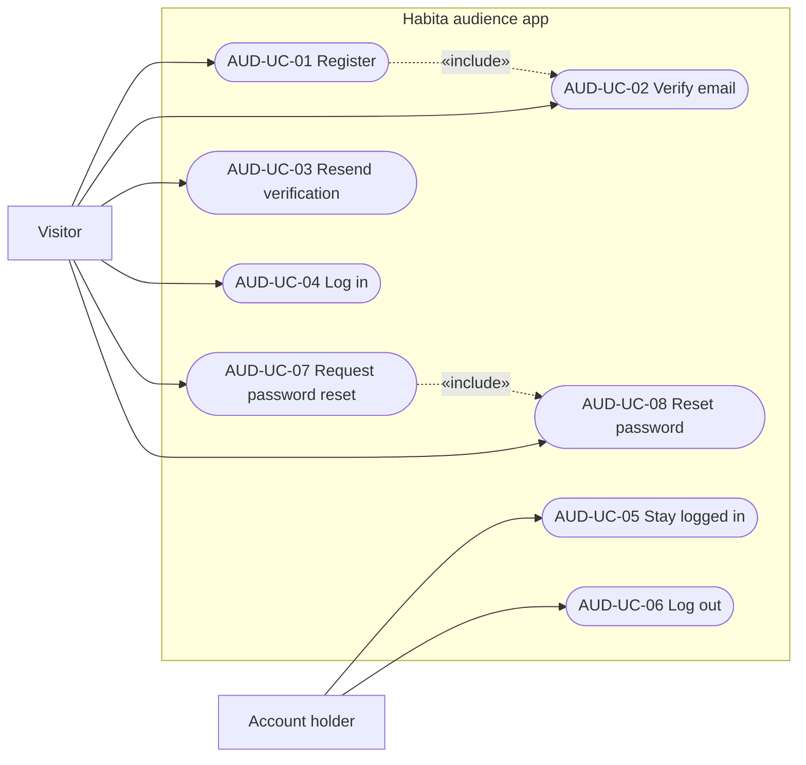

### B8.2 Use case specifications

Common preconditions: every failure message is in §B13.5 or §B14.

| UC | Name | Main flow | Alternate flows | FRs |
|---|---|---|---|---|
| AUD-UC-01 | Register | 1. Fill in the form. 2. Submit. 3. Account created, unverified. 4. Mail sent. 5. Check your email. | 2a Invalid fields: messages under fields. 3a Email taken: message under Email. 3b Too many requests or other failure: banner, fields kept. | AUD-FR-REG-01…04, AUD-FR-MAIL-01…05, AUD-FR-UI-03…05 |
| AUD-UC-02 | Verify email | 1. Open the link. 2. Account verified. 3. Log in shows the success banner. | 2a Expired or invalid: Log in shows the expired banner. 2b Already verified: same as success. | AUD-FR-VER-01…03, AUD-FR-UI-06 |
| AUD-UC-03 | Resend verification | 1. Press Resend email. 2. Same reply whatever the account's state. 3. Confirmation in the card. | 2a Too many requests: banner with the wait. | AUD-FR-VER-04…05, AUD-FR-UI-05, AUD-FR-UI-06 |
| AUD-UC-04 | Log in | 1. Enter credentials. 2. Submit. 3. Token issued. 4. Home. | 3a Wrong credentials. 3b Unverified. 3c Deactivated. 3d Too many attempts. 3e Other failure. | AUD-FR-SES-01…06, AUD-FR-UI-06 |
| AUD-UC-05 | Stay logged in | 1. Open the app with a token. 2. `me` succeeds. 3. Home. | 2a 401: refresh once, retry. 2b Refresh fails: Log in with the expired banner. 2c 403 deactivated: Log in with the deactivated banner. | AUD-FR-SES-07, AUD-FR-SES-09…11, AUD-FR-UI-07…09 |
| AUD-UC-06 | Log out | 1. Press Log out. 2. Token rejected from now on. 3. Log in. | 2a Request fails: log out locally anyway. | AUD-FR-SES-08, AUD-FR-UI-07 |
| AUD-UC-07 | Request password reset | 1. Enter email. 2. Same reply in every case. 3. Check your email. | 1a Invalid email. 2a Too many requests. | AUD-FR-PWD-01…03, AUD-FR-UI-10…11 |
| AUD-UC-08 | Reset password | 1. Open the link. 2. Enter a new password twice. 3. Password updated. 4. Log in. | 2a Weak or mismatched. 3a Expired or used: expired card. | AUD-FR-PWD-04…07, AUD-FR-UI-12…13 |

## B9. Activity diagrams

### B9.1 Log in (AUD-UC-04)

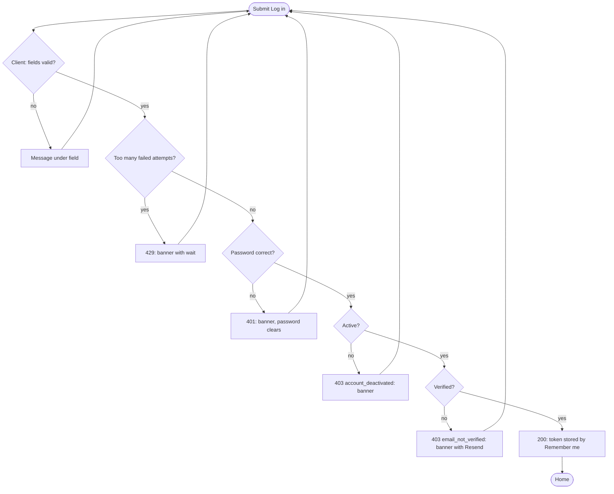

### B9.2 Password reset (AUD-UC-07, AUD-UC-08)

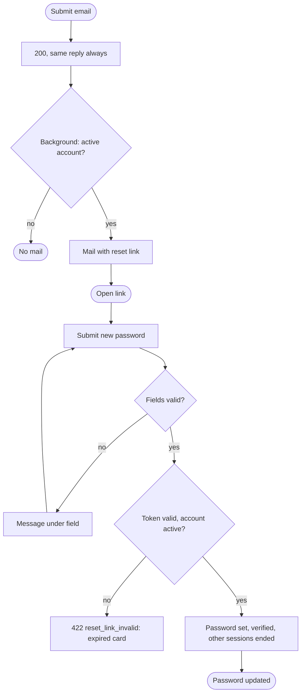

### B9.3 Screen navigation map

The Figma section "Audience (AUD)" opens with the AUD-S-00 flow map, drawn from this map (§G1.1). This Mermaid copy is the normative text version. Every edge names its IX row.

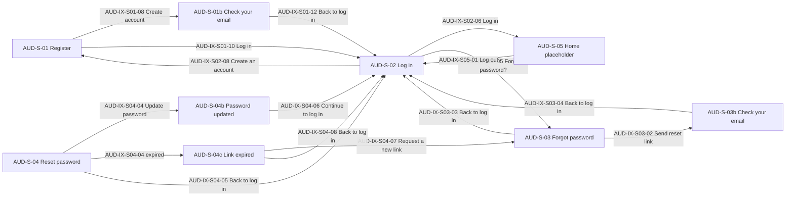

## B10. Sequence diagrams

### B10.1 Register and verify

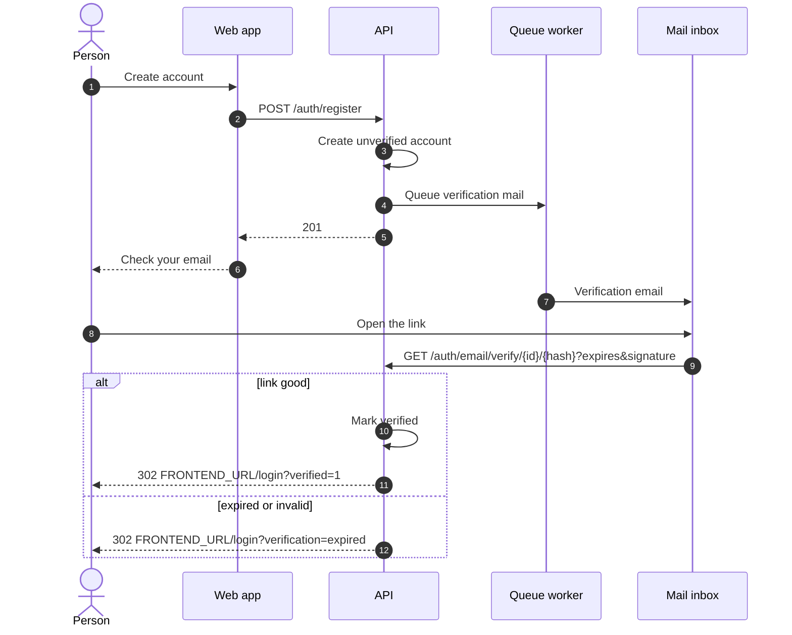

### B10.2 Session with silent refresh

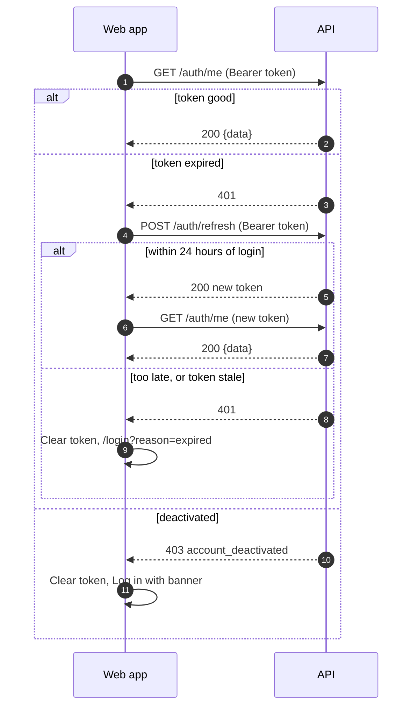

### B10.3 Checks on every audience route

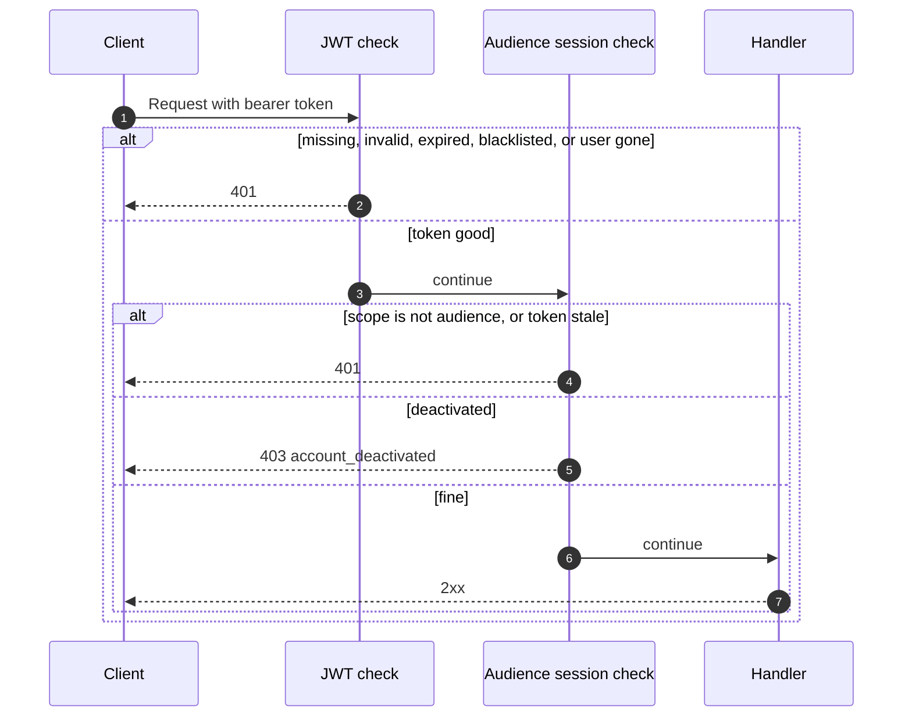

## B11. State diagram — audience account

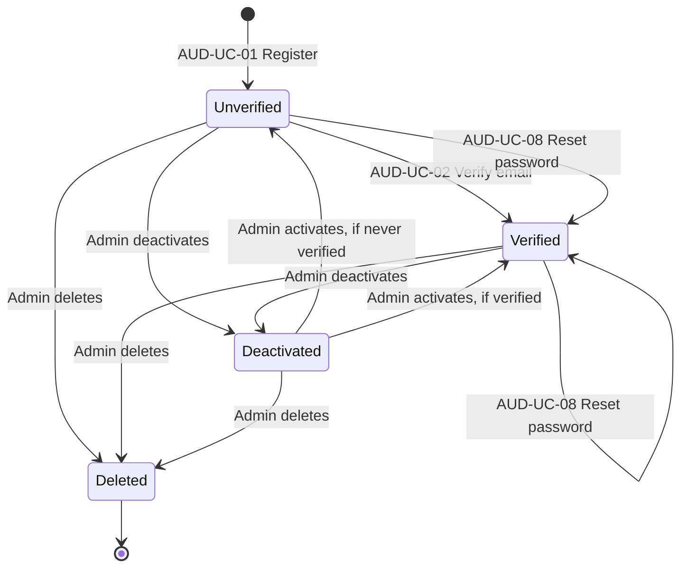

## B12. Functional requirements

### B12.1 Mail

| ID | Requirement |
|---|---|
| AUD-FR-MAIL-01 | The system sends two emails, built from Markdown templates, with the exact text in §B14.2. |
| AUD-FR-MAIL-02 | Mail is sent by a background worker. A `queue` service runs it in both the development and production compose files. |
| AUD-FR-MAIL-03 | In development, mail is delivered to a Mailpit container (SMTP on 1025, inbox on `http://localhost:8025`). Nothing leaves the machine. Moving to a real provider later changes environment settings only. |
| AUD-FR-MAIL-04 | Links in emails are built from two settings: `APP_URL` (the API's public address) and `FRONTEND_URL` (the web app's public address). `APP_URL` must equal the address the API answers on. The checked-in `.env.example` defaults to `http://localhost` (port 80) and `http://localhost:5173`. The local Docker stack sets `APP_URL=http://localhost:8000` (§G7.2). |
| AUD-FR-MAIL-05 | Emails contain no text supplied by a person (AUD-BR-19). |

### B12.2 Register

| ID | Requirement |
|---|---|
| AUD-FR-REG-01 | `POST /auth/register` creates an active, unverified account with no roles, storing `terms_accepted_at`, and answers 201. |
| AUD-FR-REG-02 | Input is validated per §B13.4. Email is trimmed and lower-cased before the uniqueness check, and name is trimmed. |
| AUD-FR-REG-03 | A verification email is queued on success. |
| AUD-FR-REG-04 | Register is rate-limited per AUD-BR-09. |

### B12.3 Verification

| ID | Requirement |
|---|---|
| AUD-FR-VER-01 | `GET /auth/email/verify/{id}/{hash}` with a good signature and a matching hash marks an active, unverified account verified and redirects to `{FRONTEND_URL}/login?verified=1`. |
| AUD-FR-VER-02 | The same link on an already verified, active account redirects to the same URL and changes nothing. |
| AUD-FR-VER-03 | An expired or tampered signature, a wrong hash, an unknown or soft-deleted id, or a deactivated account redirects to `{FRONTEND_URL}/login?verification=expired`. |
| AUD-FR-VER-04 | `POST /auth/email/resend` always answers the same 200. A verification email is queued only for an active, unverified account (AUD-BR-10). |
| AUD-FR-VER-05 | Resend is rate-limited per AUD-BR-09. |

### B12.4 Sessions

| ID | Requirement |
|---|---|
| AUD-FR-SES-01 | `POST /auth/login` accepts `email`, `password` and optional `remember`. On success it returns the token body in §B13.3. |
| AUD-FR-SES-02 | Wrong credentials and soft-deleted accounts get 401 with the generic message. Unknown emails take as long as wrong passwords. |
| AUD-FR-SES-03 | Login rejects deactivated (403 `account_deactivated`) and then unverified (403 `email_not_verified`) accounts, only after the password is verified (AUD-BR-11). No token is issued. |
| AUD-FR-SES-04 | Login is rate-limited per AUD-BR-08, with its own counter separate from admin login. |
| AUD-FR-SES-05 | Token lifetime follows AUD-BR-12. `expires_in` is `2592000` with remember and `3600` without. |
| AUD-FR-SES-06 | Audience tokens carry the claim `scope: "audience"`, and it survives a refresh. Admin routes, including `POST /admin/auth/refresh`, answer 401 `Unauthenticated.` to them. Audience routes answer 401 to tokens without it. |
| AUD-FR-SES-07 | `GET /auth/me` returns `{data: AudienceUser}`. |
| AUD-FR-SES-08 | `POST /auth/logout` blacklists the token immediately and answers 204. |
| AUD-FR-SES-09 | `POST /auth/refresh` returns a new 60-minute token for a token up to 24 hours after its login, and blacklists the old one. It answers 401 for a token past that window, a stale token, a non-audience token or a soft-deleted account, and 403 `account_deactivated` for a deactivated account. It doesn't require verified, because an audience token can't exist without it. |
| AUD-FR-SES-10 | Every audience route and refresh rejects stale tokens with 401 (AUD-BR-16). |
| AUD-FR-SES-11 | Audience routes don't rotate tokens. No response carries an `Authorization` header. |

### B12.5 Password recovery

| ID | Requirement |
|---|---|
| AUD-FR-PWD-01 | `POST /auth/forgot-password` always answers the same 200 (AUD-BR-10). |
| AUD-FR-PWD-02 | A reset email is queued only for an active account, verified or not. The lookup, the token and the mail all happen in the background, so the response time doesn't depend on the account. |
| AUD-FR-PWD-03 | Forgot password is rate-limited per AUD-BR-09. The framework's own per-account reset limiter is turned off, so every request that passes AUD-BR-09 sends mail. |
| AUD-FR-PWD-04 | The reset link is `{FRONTEND_URL}/reset-password?token={token}&email={url-encoded email}`. |
| AUD-FR-PWD-05 | `POST /auth/reset-password` with a valid token and email, on an active account, applies AUD-BR-15 and AUD-BR-16, deletes the token and answers 200. |
| AUD-FR-PWD-06 | Input is validated per §B13.4 before the token is checked. |
| AUD-FR-PWD-07 | An expired, used, unknown or mismatched token, or a deactivated account, gets 422 with `code: "reset_link_invalid"`. |

### B12.6 Frontend UI

All audience pages sit on the Milky Way backdrop and use one glass card (432 px wide at most, 16 px side gutter). The look is defined by the Figma frames in the section "Audience (AUD)" (§G1.1): each screen and card state is one frame, named with its screen ID and title, for example `AUD-S-01b Check your email`. **Keep the glass CSS and the SVG lens exactly as they are** (owner decision). The design tweak controls of the original canvas (accent, frost) were not built. Defaults apply: accent `#4FD8D0`, frost `12px`.

The frames are hi-fi, by owner request, and follow the same conventions as the admin frames: a flow map (AUD-S-00), numbered controls and an Interactions panel per screen (§G1.1). The IX tables in §B12.7 win over the frames.

| ID | Requirement |
|---|---|
| AUD-FR-UI-01 | **Interactions are specified per control.** Every control that does something has an IX row in §B12.7. Those rows win over the Figma frames. |
| AUD-FR-UI-02 | **Routes.** `/register` AUD-S-01, `/login` AUD-S-02, `/forgot-password` AUD-S-03, `/reset-password` AUD-S-04, `/` AUD-S-05. Unknown URLs outside `/admin` redirect to `/`. `/admin` and everything under it stay as they are. |
| AUD-FR-UI-03 | **AUD-S-01 Register** (`/register`, title `Habita: create account`). Heading "Create your account", sub-heading "Build good habits and keep them." Fields, in order: Name, Email, Password with hint, Confirm password, terms checkbox. Button "Create account", while sending "Creating account". Footer "Already have an account?" + "Log in". |
| AUD-FR-UI-04 | **AUD-S-01 client checks.** On submit, in this order of fields: name not blank after trimming; email matches `^[^\s@]+@[^\s@]+\.[^\s@]+$` after trimming; password has at least 12 characters, a lower-case letter, an upper-case letter and a digit; confirmation equals the password; terms ticked. Each failure shows its §B14.1 message under its control, the hint is replaced by the error, and nothing is sent. Editing a control clears its message. |
| AUD-FR-UI-05 | **AUD-S-01b Check your email** replaces the form in the same card on 201, without changing the URL. It shows the submitted email. Heading "Check your email". |
| AUD-FR-UI-06 | **AUD-S-02 Log in** (`/login`, title `Habita: log in`). Heading "Welcome back", sub-heading "Log in and keep your habits going." Fields Email, Password, checkbox Remember me (off by default), link "Forgot password?". Button "Log in", while sending "Logging in". Footer "New to Habita?" + "Create an account". At most one banner shows at a time, at the top of the form, and a new submit clears it. |
| AUD-FR-UI-07 | **AUD-S-05 Home placeholder** (`/`, title `Habita`). A glass card with heading "Logged in", the literal text "[AUDIENCE HOME: NOT DESIGNED YET]", and a Log out button. Needs a session: without one, it redirects to `/login`. |
| AUD-FR-UI-08 | **Token storage.** The token is stored under the key `habita.audience.token`: in `localStorage` when Remember me was ticked, otherwise in `sessionStorage`. Logging out or a session ending clears both. It's sent as `Authorization: Bearer` to `/auth/me`, `/auth/logout` and `/auth/refresh`. |
| AUD-FR-UI-09 | **Session handling.** On load with a stored token, the app calls `GET /auth/me`, showing "Loading…" in the card until it answers. A 401 from `/auth/me` triggers one single-flight `POST /auth/refresh` and one retry. If that fails, the token is cleared and the visitor goes to `/login?reason=expired`. A 403 `account_deactivated` from either clears the token and goes to `/login` showing the API's message. Any other failure keeps the token and AUD-S-05 shows the generic banner instead of the placeholder text. |
| AUD-FR-UI-10 | **AUD-S-03 Forgot password** (`/forgot-password`, title `Habita: forgot password`). Heading "Forgot your password?", sub-heading "Enter your email and we will send you a link to reset it." Field Email. Button "Send reset link", while sending "Sending link". Footer link "Back to log in". |
| AUD-FR-UI-11 | **AUD-S-03b Check your email** replaces the form in the same card on 200, showing the submitted email. |
| AUD-FR-UI-12 | **AUD-S-04 Reset password** (`/reset-password?token=…&email=…`, title `Habita: reset password`). Heading "Choose a new password", sub-heading "You will use it to log in from now on." Fields New password with hint, Confirm new password. Button "Update password", while sending "Updating password". Footer link "Back to log in". Nothing leads here except the email link. It's open to logged-in visitors too. |
| AUD-FR-UI-13 | **AUD-S-04b and AUD-S-04c.** AUD-S-04b Password updated and AUD-S-04c Link expired replace the form in the same card. If `token` or `email` is missing from the URL, AUD-S-04c shows on load (AUD-D-15). |
| AUD-FR-UI-14 | **Guests only.** `/login`, `/register` and `/forgot-password` redirect a visitor with a live session to `/`. |
| AUD-FR-UI-15 | **Sending state.** While a request is in flight the button shows a spinner and its sending label, the inputs and eye buttons are disabled, and a second submit does nothing. |
| AUD-FR-UI-16 | **Keyboard and focus.** Enter submits each form. After a failed submit, focus moves to the first control with a message. When a card changes to AUD-S-01b, AUD-S-03b, AUD-S-04b or AUD-S-04c, focus moves to its heading. |
| AUD-FR-UI-17 | **Responsive.** All pages work down to 320 px wide with no horizontal scroll. Touch targets are at least 44 px. |
| AUD-FR-UI-18 | **Assets.** The Milky Way image is bundled with the app. Fonts Bricolage Grotesque and Instrument Sans load from Google Fonts. The admin panel's look doesn't change: audience CSS is scoped so it can't reach admin pages. |
| AUD-FR-UI-19 | **Navigation behaviour.** Links inside the app are client-side and add a history entry. Leaving a form with entered data discards it without a prompt. Banners from query strings show once per page load. Dialogs don't exist in this feature. |

### B12.7 Screen interactions (IX)

**Conventions, everywhere:**
- *Field 422*: each `errors.<field>[0]` shows under that field. All entered data stays.
- *429*: the API's `message` shows in the top banner.
- *Other failure* (network error, 5xx, anything else): the banner shows "Something went wrong. Please try again." All entered data stays.

**AUD-S-01 Register**

| IX | Control | Shown when | Trigger | Request | On success | On failure |
|---|---|---|---|---|---|---|
| AUD-IX-S01-01 | Name input | form | type | none | clears its message | — |
| AUD-IX-S01-02 | Email input | form | type | none | clears its message | — |
| AUD-IX-S01-03 | Password input | form | type | none | clears its message, hint returns | — |
| AUD-IX-S01-04 | Eye on Password | form | click | none | toggles text/password, `aria-label` "Show password" / "Hide password", `aria-pressed` | — |
| AUD-IX-S01-05 | Confirm password input | form | type | none | clears its message | — |
| AUD-IX-S01-06 | Eye on Confirm password | form | click | none | as AUD-IX-S01-04 | — |
| AUD-IX-S01-07 | Terms checkbox | form | click | none | clears its message | — |
| AUD-IX-S01-08 | Create account (or Enter) | form | submit | AUD-FR-UI-04 checks, then `POST /auth/register` | AUD-S-01b | field 422, 429, other failure |
| AUD-IX-S01-09 | Terms of Service, Privacy Policy links | form | click | none | placeholders: `href="#terms"`, `href="#privacy"`, stay on the page | — |
| AUD-IX-S01-10 | Log in link | form | click | none | `/login` | — |
| AUD-IX-S01-11 | Resend email | AUD-S-01b | click | `POST /auth/email/resend` with the submitted email | stay, notice "Verification email sent again." | 429, other failure: banner in the card |
| AUD-IX-S01-12 | Back to log in | AUD-S-01b | click | none | `/login` | — |

**AUD-S-02 Log in**

| IX | Control | Shown when | Trigger | Request | On success | On failure |
|---|---|---|---|---|---|---|
| AUD-IX-S02-01 | Email input | always | type | none | clears its message | — |
| AUD-IX-S02-02 | Password input | always | type | none | clears its message | — |
| AUD-IX-S02-03 | Eye on Password | always | click | none | as AUD-IX-S01-04 | — |
| AUD-IX-S02-04 | Remember me | always | click | none | changes storage per AUD-FR-UI-08 on the next login | — |
| AUD-IX-S02-05 | Forgot password? | always | click | none | `/forgot-password` | — |
| AUD-IX-S02-06 | Log in (or Enter) | always | submit | checks email and that password isn't empty, then `POST /auth/login` with `remember` | store the token, go to `/` | 401: banner "These credentials do not match our records.", password clears. 403 `email_not_verified`: banner with Resend email. 403 `account_deactivated`: banner with the API's message. Field 422, 429, other failure |
| AUD-IX-S02-07 | Resend email | after 403 `email_not_verified` | click | `POST /auth/email/resend` with the email from the form | banner becomes "Verification email sent. Open the link, then log in." | 429, other failure: banner replaced |
| AUD-IX-S02-08 | Create an account | always | click | none | `/register` | — |
| AUD-IX-S02-09 | Banner from URL | on arrival | automatic | none | `?verified=1`: success banner "Email verified. You can log in now." `?verification=expired`: neutral banner "This verification link has expired. Log in to request a new one." `?reason=expired`: neutral banner "Your session has expired. Please log in again." Location state `message`: error banner with that text. | — |

**AUD-S-03 Forgot password**

| IX | Control | Shown when | Trigger | Request | On success | On failure |
|---|---|---|---|---|---|---|
| AUD-IX-S03-01 | Email input | form | type | none | clears its message | — |
| AUD-IX-S03-02 | Send reset link (or Enter) | form | submit | checks email, then `POST /auth/forgot-password` | AUD-S-03b | field 422, 429, other failure |
| AUD-IX-S03-03 | Back to log in | form | click | none | `/login` | — |
| AUD-IX-S03-04 | Back to log in | AUD-S-03b | click | none | `/login` | — |
| AUD-IX-S03-05 | Resend email | AUD-S-03b | click | `POST /auth/forgot-password` with the submitted email | stay, notice "Reset email sent again." | 429, other failure: banner in the card |

**AUD-S-04 Reset password**

| IX | Control | Shown when | Trigger | Request | On success | On failure |
|---|---|---|---|---|---|---|
| AUD-IX-S04-01 | New password input | form | type | none | clears its message, hint returns | — |
| AUD-IX-S04-02 | Eye buttons | form | click | none | as AUD-IX-S01-04 | — |
| AUD-IX-S04-03 | Confirm new password input | form | type | none | clears its message | — |
| AUD-IX-S04-04 | Update password (or Enter) | form | submit | checks password and match, then `POST /auth/reset-password` with `token` and `email` from the URL | AUD-S-04b | 422 `reset_link_invalid`, or errors on `token` or `email`: AUD-S-04c. Field 422 on `password` or `password_confirmation`. Other failure |
| AUD-IX-S04-05 | Back to log in | form | click | none | `/login` | — |
| AUD-IX-S04-06 | Continue to log in | AUD-S-04b | click | none | `/login` | — |
| AUD-IX-S04-07 | Request a new link | AUD-S-04c | click | none | `/forgot-password` | — |
| AUD-IX-S04-08 | Back to log in | AUD-S-04c | click | none | `/login` | — |

**AUD-S-05 Home placeholder and global**

| IX | Control | Shown when | Trigger | Request | On success | On failure |
|---|---|---|---|---|---|---|
| AUD-IX-S05-01 | Log out | AUD-S-05 | click | `POST /auth/logout` | clear the token, go to `/login` | same: log out locally anyway |
| AUD-IX-GL-01 | Session expired | any audience call gets 401 after one refresh | automatic | `POST /auth/refresh` once | — | clear the token, go to `/login?reason=expired` |
| AUD-IX-GL-02 | Account deactivated | any audience call gets 403 `account_deactivated` | automatic | none | — | clear the token, go to `/login` with the API's message |
| AUD-IX-GL-03 | Unknown URL | any URL with no route outside `/admin` | automatic | none | `/` | — |
| AUD-IX-GL-04 | Guest-only redirect | live session on `/login`, `/register`, `/forgot-password` | automatic | none | `/` | — |

## B13. API contract

This section is the only link between the two repos. It's copied unchanged into every build plan.

Base URL: `{API}/api/v1`, where `{API}` is the API's public address (local Docker stack: `http://localhost:8000`, §G7.2). Every request sends `Accept: application/json`, and a request with a body sends `Content-Type: application/json`. Routes marked **bearer** need `Authorization: Bearer <token>`. CORS allows the web app's origin, and no cookies are used.

### B13.1 Endpoints

| # | Method and path | Access | Limit | Success |
|---|---|---|---|---|
| 1 | `POST /auth/register` | public | 5 a minute per IP | 201 |
| 2 | `GET /auth/email/verify/{id}/{hash}?expires=…&signature=…` | signed link | 60 a minute per IP | 302 |
| 3 | `POST /auth/email/resend` | public | 3 a minute per email + IP | 200 |
| 4 | `POST /auth/login` | public | 5 failed a minute per email + IP | 200 |
| 5 | `GET /auth/me` | bearer | — | 200 |
| 6 | `POST /auth/logout` | bearer | — | 204 |
| 7 | `POST /auth/refresh` | bearer, may be expired | 60 a minute per IP | 200 |
| 8 | `POST /auth/forgot-password` | public | 3 a minute per email + IP | 200 |
| 9 | `POST /auth/reset-password` | public | 10 a minute per IP | 200 |

### B13.2 Requests and responses

**1. `POST /auth/register`**

```json
{
  "name": "Sam Rivera",
  "email": "sam@example.com",
  "password": "Morning-walks-7",
  "password_confirmation": "Morning-walks-7",
  "terms": true
}
```

| Status | Body |
|---|---|
| 201 | `{"message": "Check your email to verify your account."}` |
| 422 | Validation shape, §B13.5. Fields: `name`, `email`, `password`, `password_confirmation`, `terms` |
| 429 | `{"message": "Too many requests. Please try again in 42 seconds."}` |

**2. `GET /auth/email/verify/{id}/{hash}?expires=…&signature=…`**

A person opens this from an email. It always redirects. No JSON.

| Case | Response |
|---|---|
| Good link, verified now or already | 302 `{FRONTEND_URL}/login?verified=1` |
| Anything else (expired, tampered, wrong hash, unknown id, deactivated) | 302 `{FRONTEND_URL}/login?verification=expired` |

**3. `POST /auth/email/resend`**

```json
{ "email": "sam@example.com" }
```

| Status | Body |
|---|---|
| 200 | `{"message": "If your account needs verification, we sent a new link."}` (same in every case) |
| 422 | Field: `email` |
| 429 | As endpoint 1 |

**4. `POST /auth/login`**

```json
{ "email": "sam@example.com", "password": "Morning-walks-7", "remember": true }
```

`remember` is optional and defaults to `false`.

| Status | Body |
|---|---|
| 200 | Token body, §B13.3 |
| 401 | `{"message": "These credentials do not match our records."}` |
| 403 | `{"message": "Your account has been deactivated.", "code": "account_deactivated"}` |
| 403 | `{"message": "Verify your email before logging in.", "code": "email_not_verified"}` |
| 422 | Fields: `email`, `password`, `remember` |
| 429 | `{"message": "Too many login attempts. Please try again in 42 seconds."}` |

**5. `GET /auth/me`** (bearer)

| Status | Body |
|---|---|
| 200 | `{"data": AudienceUser}` |
| 401 | `{"message": "Unauthenticated."}` |
| 403 | `{"message": "Your account has been deactivated.", "code": "account_deactivated"}` |

**6. `POST /auth/logout`** (bearer)

| Status | Body |
|---|---|
| 204 | none |
| 401 | `{"message": "Unauthenticated."}` |
| 403 | `{"message": "Your account has been deactivated.", "code": "account_deactivated"}` |

**7. `POST /auth/refresh`** (bearer: the current token, which may be expired)

| Status | Body |
|---|---|
| 200 | Token body, §B13.3. `expires_in` is `3600`. The old token stops working. |
| 401 | `{"message": "Unauthenticated."}` |
| 403 | `{"message": "Your account has been deactivated.", "code": "account_deactivated"}` |

**8. `POST /auth/forgot-password`**

```json
{ "email": "sam@example.com" }
```

| Status | Body |
|---|---|
| 200 | `{"message": "If an account exists for this email, we sent a reset link."}` (same in every case) |
| 422 | Field: `email` |
| 429 | As endpoint 1 |

**9. `POST /auth/reset-password`**

```json
{
  "token": "the token from the link",
  "email": "sam@example.com",
  "password": "Evening-reads-4",
  "password_confirmation": "Evening-reads-4"
}
```

| Status | Body |
|---|---|
| 200 | `{"message": "Your password has been updated."}` |
| 422 | Fields: `token`, `email`, `password`, `password_confirmation` |
| 422 | `{"message": "This reset link has expired or has already been used.", "code": "reset_link_invalid"}` |
| 429 | As endpoint 1 |

### B13.3 Resource shapes

**Token body**

```jsonc
{
  "access_token": "eyJ0eXAiOiJKV1Qi...",
  "token_type": "bearer",
  "expires_in": 3600,                  // seconds; 2592000 when remember is true
  "user": {                            // AudienceUser
    "id": 7,
    "name": "Sam Rivera",
    "email": "sam@example.com"
  }
}
```

`AudienceUser` holds exactly `id`, `name` and `email`. No response contains a password, a reset token, roles or permissions.

### B13.4 Validation rules

| Endpoint | Field | Rules | Message |
|---|---|---|---|
| Register | `name` | required, string, trimmed, 255 characters at most | Empty: `Enter your name.` Too long: `Use 255 characters or fewer.` |
| Register | `email` | required, valid email, 255 at most, trimmed, lower-cased, unique across all accounts (AUD-BR-02) | Invalid: `Enter a valid email address.` Taken: `This email is already in use.` |
| Register, Reset | `password` | required, password policy (AUD-BR-03) | `At least 12 characters with upper- and lower-case letters and a number.` |
| Register, Reset | `password_confirmation` | required, same as `password` | `Passwords do not match.` |
| Register | `terms` | must be accepted (`true`) | `Accept the Terms of Service and Privacy Policy to continue.` |
| Login | `email` | required, valid email | `Enter a valid email address.` |
| Login | `password` | required | `Enter your password.` |
| Login | `remember` | optional boolean | `Invalid value.` |
| Resend, Forgot | `email` | required, valid email, 255 at most | `Enter a valid email address.` |
| Reset | `token` | required, string | `This reset link has expired or has already been used.` |
| Reset | `email` | required, valid email | `This reset link has expired or has already been used.` |

### B13.5 Error shapes

| Status | When | Body |
|---|---|---|
| 401 | Missing, invalid, expired, blacklisted or stale token, wrong `scope`, or the user no longer exists | `{"message": "Unauthenticated."}` |
| 403 | Deactivated | `{"message": "Your account has been deactivated.", "code": "account_deactivated"}` |
| 422 | Validation | `{"message": "Enter a valid email address.", "errors": {"email": ["Enter a valid email address."]}}` |
| 429 | Limit reached | `message` as in §B13.2, plus the header `Retry-After: <seconds>` |

Callers branch on the status and `code`, and show `message` verbatim where §B12.7 says so. `N` in a 429 message is the real number of seconds left.

### B13.6 Links in email

| Email | Link |
|---|---|
| Verification | `{API}/api/v1/auth/email/verify/{id}/{hash}?expires=…&signature=…`. It works for 24 hours. |
| Reset | `{FRONTEND_URL}/reset-password?token={token}&email={url-encoded email}`. It works for 60 minutes, once. |

## B14. UI copy catalogue

### B14.1 Field and banner text

All field messages match §B13.4, because the client checks first and the API backs it up.

| Key | Text |
|---|---|
| name.required | Enter your name. |
| email.invalid | Enter a valid email address. |
| email.taken | This email is already in use. |
| password.rule | At least 12 characters with upper- and lower-case letters and a number. |
| password.mismatch | Passwords do not match. |
| password.required | Enter your password. |
| terms.required | Accept the Terms of Service and Privacy Policy to continue. |
| terms.label | I agree to the Terms of Service and Privacy Policy. |
| generic | Something went wrong. Please try again. |
| login.wrong | These credentials do not match our records. |
| login.unverified | Verify your email before logging in. Resend email |
| login.resent | Verification email sent. Open the link, then log in. |
| login.verified | Email verified. You can log in now. |
| login.linkExpired | This verification link has expired. Log in to request a new one. |
| login.sessionExpired | Your session has expired. Please log in again. |
| register.done.title | Check your email |
| register.done.body | We sent a verification link to {email}. Open it to activate your account. |
| register.resent | Verification email sent again. |
| done.prompt | Did not get it? |
| done.resend | Resend email |
| done.back | Back to log in |
| forgot.done.title | Check your email |
| forgot.done.body | If an account exists for {email}, we sent a link to reset the password. It works for 60 minutes. |
| forgot.resent | Reset email sent again. |
| reset.done.title | Password updated |
| reset.done.body | You can now log in with your new password. |
| reset.done.button | Continue to log in |
| reset.expired.title | This link has expired |
| reset.expired.body | Reset links work for 60 minutes and can be used once. Request a new one to continue. |
| reset.expired.button | Request a new link |
| home.title | Logged in |
| home.body | [AUDIENCE HOME: NOT DESIGNED YET] |
| home.logout | Log out |

### B14.2 Email text

Both emails use Habita as the sender name and have no greeting name (AUD-BR-19).

**Verification email**

| Part | Text |
|---|---|
| Subject | Verify your Habita email |
| Greeting | Hello, |
| Body | Thanks for joining Habita. Open the link below to verify your email and activate your account. |
| Button | Verify email |
| After the button | This link works for 24 hours. If you did not create a Habita account, you can ignore this email. |
| Sign-off | The Habita team |

**Reset email**

| Part | Text |
|---|---|
| Subject | Reset your Habita password |
| Greeting | Hello, |
| Body | We received a request to reset the password for your Habita account. |
| Button | Reset password |
| After the button | This link works for 60 minutes and can be used once. If you did not ask for this, you can ignore this email and your password stays the same. |
| Sign-off | The Habita team |

## B15. Acceptance criteria (Given / When / Then)

### Mail

- **AUD-AC-MAIL-01** Given a verification email is rendered, then its subject, body, button and sign-off match §B14.2 and it has both HTML and plain-text parts.
- **AUD-AC-MAIL-02** Given a reset email is rendered, then its subject, body, button and sign-off match §B14.2 and it has both HTML and plain-text parts.
- **AUD-AC-MAIL-03** Given an account named `[Click](http://evil.test)`, when either email is rendered, then the name doesn't appear in it.
- **AUD-AC-MAIL-04** Given `docker compose up -d`, then `mailpit` and `queue` are running, and a registration puts a message in the inbox at `http://localhost:8025` within 10 seconds.
- **AUD-AC-MAIL-05** Given the verification email in Mailpit, when its link is opened, then the host and port match `APP_URL` and the response is a 302.

### Register

- **AUD-AC-REG-01** Given no account for `sam@example.com`, when a visitor registers with valid input, then the API answers 201 with the exact message, an account exists with that lower-cased email, no roles, `email_verified_at` null and `terms_accepted_at` set, and a verification email is queued for it.
- **AUD-AC-REG-02** Given ` SAM@Example.com `, when registering, then the stored email is `sam@example.com` and the name is trimmed.
- **AUD-AC-REG-03** Given each invalid field in §B13.4, when registering, then the API answers 422 with that exact message under that field and creates no account. Dataset: blank name, 256-character name, bad email, each password failure, mismatch, `terms: false`, `terms` missing.
- **AUD-AC-REG-04** Given an account for `sam@example.com`, active or soft-deleted, when registering `SAM@example.com`, then the API answers 422 with `This email is already in use.` under `email`.
- **AUD-AC-REG-05** Given 5 registrations from one IP in a minute, when a 6th arrives, then the API answers 429 with the exact message and `Retry-After`.
- **AUD-AC-REG-06** Given a successful registration, then the response has no password and the new account can't reach any `/admin/*` route.

### Verification

- **AUD-AC-VER-01** Given a fresh verification link for an unverified account, when it's opened, then `email_verified_at` is set and the response is a 302 to `{FRONTEND_URL}/login?verified=1`.
- **AUD-AC-VER-02** Given a verified account, when its link is opened again, then the response is the same 302 and `email_verified_at` doesn't change.
- **AUD-AC-VER-03** Given each of: expired link, altered signature, wrong hash, unknown id, soft-deleted account, deactivated account; when opened, then the response is a 302 to `{FRONTEND_URL}/login?verification=expired` and nothing changes.
- **AUD-AC-VER-04** Given a link is 23 hours 59 minutes old, it works. Given it's 24 hours 1 minute old, it doesn't.
- **AUD-AC-VER-05** Given an active unverified account, when Resend is called, then the API answers 200 with the exact message and one verification email is queued.
- **AUD-AC-VER-06** Given each of: unknown email, verified, deactivated, soft-deleted; when Resend is called, then the status and body match AUD-AC-VER-05 and no mail is sent.
- **AUD-AC-VER-07** Given 3 Resend calls for one email and IP in a minute, when a 4th arrives, then the API answers 429 with the exact message and `Retry-After`, and the same applies to an unknown email.

### Sessions

- **AUD-AC-SES-01** Given a verified active account, when logging in without `remember`, then the API answers 200 with the §B13.3 shape, `expires_in` 3600, and `user` holding exactly `id`, `name`, `email`.
- **AUD-AC-SES-02** Given the same, when logging in with `remember: true`, then `expires_in` is 2592000 and the token still works 29 days later.
- **AUD-AC-SES-03** Given a wrong password, an unknown email or a soft-deleted account, when logging in, then the API answers 401 with the exact message.
- **AUD-AC-SES-04** Given a deactivated unverified account and the right password, when logging in, then the API answers 403 `account_deactivated`. With a wrong password it answers 401.
- **AUD-AC-SES-05** Given an unverified account and the right password, when logging in, then the API answers 403 `email_not_verified`. With a wrong password it answers 401.
- **AUD-AC-SES-06** Given 5 failed logins for one email and IP in a minute, when a 6th arrives with any password, then the API answers 429 with the exact message. A success before that clears the count. Failed admin logins don't count towards it.
- **AUD-AC-SES-07** Given an unknown email, when logging in, then a password hash is still computed.
- **AUD-AC-SES-08** Given an audience token, when calling `GET /api/v1/admin/auth/me`, then the API answers 401 `Unauthenticated.`, including when the account is a super admin.
- **AUD-AC-SES-09** Given an audience token that has been refreshed, when calling `GET /api/v1/admin/auth/me` with the new token, then the API answers 401.
- **AUD-AC-SES-10** Given an audience token, when calling `POST /api/v1/admin/auth/refresh`, then the API answers 401.
- **AUD-AC-SES-11** Given a token from `POST /admin/auth/login`, when calling `GET /auth/me`, then the API answers 401.
- **AUD-AC-SES-12** Given a valid audience token, when calling `GET /auth/me`, then the API answers 200 with `{data: AudienceUser}` and no `Authorization` response header.
- **AUD-AC-SES-13** Given a valid audience token, when logging out, then the API answers 204 and the token then gets 401.
- **AUD-AC-SES-14** Given a token expired 2 hours ago from a login 3 hours ago, when refreshing, then the API answers 200 with a working token and `expires_in` 3600, and the old token gets 401.
- **AUD-AC-SES-15** Given a token from a login 25 hours ago, when refreshing, then the API answers 401.
- **AUD-AC-SES-16** Given a token and then a deactivated account, when calling `GET /auth/me` or refreshing, then the API answers 403 `account_deactivated`.
- **AUD-AC-SES-17** Given a token and then a soft-deleted account, when calling `GET /auth/me` or refreshing, then the API answers 401.
- **AUD-AC-SES-18** Given a token and then an admin changes the password, when calling `GET /auth/me` or refreshing, then the API answers 401. A login after the change works.
- **AUD-AC-SES-19** Given no token, when calling `GET /auth/me`, `POST /auth/logout` or `POST /auth/refresh`, then the API answers 401.

### Password recovery

- **AUD-AC-PWD-01** Given an active account, verified or not, when calling Forgot, then the API answers 200 with the exact message and one reset email is sent with a link in the AUD-FR-PWD-04 format.
- **AUD-AC-PWD-02** Given each of: unknown email, deactivated, soft-deleted; when calling Forgot, then the status and body match AUD-AC-PWD-01 and no mail is sent.
- **AUD-AC-PWD-03** Given any Forgot request, then no account lookup, token write or mail happens within the request: the work is a queued job.
- **AUD-AC-PWD-04** Given 3 Forgot calls for one email and IP in a minute, when a 4th arrives, then the API answers 429 with the exact message, for known and unknown emails alike.
- **AUD-AC-PWD-05** Given two Forgot calls 5 seconds apart, then two emails are sent and only the second link works.
- **AUD-AC-PWD-06** Given a valid reset link, when resetting with a valid password, then the API answers 200 with the exact message, the new password works, the old one doesn't, and the link fails if reused.
- **AUD-AC-PWD-07** Given an unverified account, when a reset completes, then `email_verified_at` is set.
- **AUD-AC-PWD-08** Given a token from a login before the reset, when a reset completes, then that token gets 401 from `GET /auth/me` and from refresh.
- **AUD-AC-PWD-09** Given a reset link 61 minutes old, when resetting, then the API answers 422 `reset_link_invalid`.
- **AUD-AC-PWD-10** Given a wrong token, or a right token with another account's email, when resetting, then the API answers 422 `reset_link_invalid`.
- **AUD-AC-PWD-11** Given an account deactivated after the link was sent, when resetting, then the API answers 422 `reset_link_invalid` and the password doesn't change.
- **AUD-AC-PWD-12** Given a weak password or a mismatch, when resetting with a valid link, then the API answers 422 with the field message and the link still works.

### Admin unaffected

- **AUD-AC-ADM-01** Given the existing Part A (admin) test suite, then every test passes unchanged.
- **AUD-AC-ADM-02** Given an admin token, when calling `/admin/auth/me`, then rotation still happens.
- **AUD-AC-ADM-03** Given a registered audience account, when an admin lists users, then it appears with no roles.

### Screens (UI)

- **AUD-AC-UI-01** (UI) Given AUD-S-01, when submitting empty, then all five messages show, nothing is sent, and focus is on Name.
- **AUD-AC-UI-02** (UI) Given AUD-S-01 with valid input, when submitting, then `POST /auth/register` is sent with trimmed name and email, the button shows "Creating account", inputs are disabled, and on 201 the card shows AUD-S-01b with the email.
- **AUD-AC-UI-03** (UI) Given a 422 for `email`, then `This email is already in use.` shows under Email and every field keeps its value.
- **AUD-AC-UI-04** (UI) Given AUD-S-02 with a 401, then the banner shows, the password clears and the email stays.
- **AUD-AC-UI-05** (UI) Given AUD-S-02 with a 403 `email_not_verified`, when pressing Resend email, then `POST /auth/email/resend` is sent with the form's email and the banner becomes the confirmation.
- **AUD-AC-UI-06** (UI) Given a login with Remember me ticked, then the token is in `localStorage` and not `sessionStorage`. Unticked, the reverse.
- **AUD-AC-UI-07** (UI) Given `/login?verified=1`, `/login?verification=expired` and `/login?reason=expired`, then each shows its banner.
- **AUD-AC-UI-08** (UI) Given a stored token and a 401 from `me`, then one refresh is sent, `me` is retried, and AUD-S-05 shows. When refresh fails, the token is cleared and the URL is `/login?reason=expired`.
- **AUD-AC-UI-09** (UI) Given a 403 `account_deactivated` from `me`, then the token is cleared and `/login` shows "Your account has been deactivated."
- **AUD-AC-UI-10** (UI) Given `me` fails with a 500, then the token stays and AUD-S-05 shows the generic banner.
- **AUD-AC-UI-11** (UI) Given AUD-S-03 with a valid email, when submitting, then AUD-S-03b shows that email and the wording is exactly §B14.1.
- **AUD-AC-UI-12** (UI) Given `/reset-password` with no token, then AUD-S-04c shows on load and no request is sent.
- **AUD-AC-UI-13** (UI) Given AUD-S-04 with a 422 `reset_link_invalid`, then AUD-S-04c shows. "Request a new link" goes to `/forgot-password`.
- **AUD-AC-UI-14** (UI) Given a live session on `/login`, then the URL becomes `/`. Given a live session on `/reset-password?token=t&email=e`, then the form shows.
- **AUD-AC-UI-15** (UI) Given `/nope`, then the URL becomes `/`. Given `/admin/nope`, the admin not-found page shows.
- **AUD-AC-UI-16** (UI) Given a 320 px wide viewport, then no page scrolls sideways.
- **AUD-AC-UI-17** (UI) Given an admin page, then its computed link colour and body background are unchanged by audience CSS.

### Navigation and interactions (all UI)

- **AUD-AC-NAV-01** (UI) Clicking Log in on AUD-S-01 goes to `/login`.
- **AUD-AC-NAV-02** (UI) Clicking Create an account on AUD-S-02 goes to `/register`.
- **AUD-AC-NAV-03** (UI) Clicking Forgot password? on AUD-S-02 goes to `/forgot-password`.
- **AUD-AC-NAV-04** (UI) Clicking Back to log in goes to `/login`, from AUD-S-01b, AUD-S-03, AUD-S-03b, AUD-S-04 and AUD-S-04c.
- **AUD-AC-NAV-05** (UI) Clicking Continue to log in on AUD-S-04b goes to `/login`.
- **AUD-AC-NAV-06** (UI) Clicking Log out on AUD-S-05 sends `POST /auth/logout`, clears the token and goes to `/login`, even if the request fails.
- **AUD-AC-NAV-07** (UI) Every IX row is covered by a UI test whose title contains its ID.

### Live

- **AUD-AC-LIVE-01** (UI, not yet delivered: FE-M3, issue #9) Against the running API: register, read the verification link from Mailpit, open it, log in, reach `/`, log out.
- **AUD-AC-LIVE-02** (UI, not yet delivered: FE-M3, issue #9) Against the running API: forgot password, read the reset link from Mailpit, reset, log in with the new password, and the old token is refused.
- **AUD-AC-LIVE-03** (not yet delivered: FE-M3, issue #9) Against the running API, every §B13.2 status and body in the contract matches, including 429 and `Retry-After`.

### Non-functional

- **AUD-AC-NFR-01** Given every §B13 endpoint, then no response contains `password`, `remember_token`, a reset token, `roles` or `permissions`.
- **AUD-AC-NFR-02** Given Forgot and Resend, then the same response headers and body come back for existing and unknown emails, apart from the request-specific ones.
- **AUD-AC-NFR-03** Given a preflight from `http://localhost:5173`, then every §B13 POST is allowed.

## B16. Non-functional requirements

| ID | Requirement |
|---|---|
| AUD-NFR-01 | **Security**: passwords hashed. `JWT_TTL=60`, `JWT_REFRESH_TTL=1440` (minutes), blacklist on. Remember-me tokens: 43200 minutes. Logout blacklists at once. |
| AUD-NFR-02 | **Enumeration**: AUD-BR-10 holds for status, body and timing. Mail work runs off the request. |
| AUD-NFR-03 | **CORS**: as Part A (ADM-NFR-02). Origin from `CORS_ALLOWED_ORIGINS`, no credentials. |
| AUD-NFR-04 | **Performance**: every endpoint answers in under 300 ms p95 locally, except password hashing paths. |
| AUD-NFR-05 | **Consistency**: creating the account and queuing its mail run in one transaction, so a failed queue write leaves no account. |
| AUD-NFR-06 | **Accessibility**: every input has a `<label>`. Messages use `role="alert"`, confirmations `role="status"`. Banners are not told apart by colour alone: each has an icon and text. Eye buttons have an `aria-label` and `aria-pressed`. Invalid fields set `aria-invalid`. Focus outlines stay visible. |
| AUD-NFR-07 | **Testing**: TDD. Backend: feature tests. Frontend: component tests with the API mocked, then live tests in the last milestone. |
| AUD-NFR-08 | **Code quality**: each repo's tests, lint and build pass. |
| AUD-NFR-09 | **Browser support**: latest two versions of Chrome, Firefox, Safari and Edge, down to 320 px wide. |

## B17. Decisions, open questions, risks

### B17.1 Decisions

| ID | Decision | Made by |
|---|---|---|
| AUD-D-01 | Audience accounts live in the `users` table with no roles and appear in the admin Users list. | Product owner |
| AUD-D-02 | The audience API sits at `/api/v1/auth/*`. Admin login doesn't change. | Product owner |
| AUD-D-03 | The email link opens the API, which verifies and redirects to `/login?verified=1`. No in-between screen. | Product owner |
| AUD-D-04 | Verification links last 24 hours. An expired one shows a Log in banner, and logging in then shows the Resend banner. | Product owner |
| AUD-D-05 | Remember me on: 30 days, survives closing the browser. Off: ends with the tab, 24 hours at most. | Product owner |
| AUD-D-06 | Tokens from audience login are refused by the admin API, and the reverse. | Product owner |
| AUD-D-07 | Password changes end audience sessions. Admin tokens keep Part A's behaviour (ADM-Q-04). | Product owner |
| AUD-D-08 | Finishing a reset also verifies the email. | Product owner |
| AUD-D-09 | Deactivated and deleted accounts get no email, with the same wording on screen. | Product owner |
| AUD-D-10 | The home placeholder gains a Log out link. | Product owner |
| AUD-D-11 | Register reveals taken emails, as designed. Rate-limited. | Product owner |
| AUD-D-12 | Mail work runs in queued jobs, with a worker in dev and prod compose. | Product owner |
| AUD-D-13 | Terms acceptance time is stored. Terms and Privacy links stay placeholders. | Product owner |
| AUD-D-14 | `/` becomes the audience home and unknown URLs go there. Admin stays under `/admin`. | Product owner |
| AUD-D-15 | An expired reset link is detected on submit. A link missing its token shows the expired card at once. | Product owner |
| AUD-D-16 | Other failures on Log in, Forgot and Reset show "Something went wrong. Please try again." A deactivated account gets a banner. | Product owner |
| AUD-D-17 | Register gains a Name field. | Product owner |
| AUD-D-18 | Development mail uses Mailpit, with Markdown templates. | Product owner |
| AUD-D-19 | No new composer or npm dependency. Mailpit is a Docker image used only in development. | Product owner |
| AUD-D-20 | Emails contain no person-supplied text (AUD-BR-19), so they have no name in the greeting. | Product owner |
| AUD-D-21 | Admin tokens are refused on audience routes, not only the reverse. | Product owner |
| AUD-D-22 | A password changed by an admin also ends audience sessions (AUD-BR-16). | Product owner |

### B17.2 Open questions

No answers were recorded, so the defaults are what was built.

| ID | Question | Default if not answered |
|---|---|---|
| AUD-Q-01 | When an admin changes a user's email, should the account become unverified? | No, it stays verified. |
| AUD-Q-02 | Should unverified accounts be deleted after some time? | No, they stay. |
| AUD-Q-03 | Should the placeholder text ship to production? | Yes until the home screen exists. It doesn't matter before launch. |

### B17.3 Risks

| ID | Risk | Mitigation |
|---|---|---|
| AUD-R-01 | The queue worker isn't running, so no mail arrives and nothing says why. | `docker compose up -d` starts it. Recovery: `docker compose ps`, `docker compose logs queue`, then `docker compose restart queue`. |
| AUD-R-02 | `APP_URL` doesn't match the real address, so verification links are dead. | AUD-AC-MAIL-05. Recovery: set `APP_URL` in `.env`, then `docker compose restart queue laravel.test`. |
| AUD-R-03 | Production can't sign anyone up without a real mail provider. | Provider setup is configuration only, and it has to happen before launch. |
| AUD-R-04 | Mail scanners open links in emails. | Verification links are safe to open twice, and a scanner verifying an address does no harm. Reset links only show a form. |
| AUD-R-05 | A 30-day token in `localStorage` is readable by XSS. | Only with Remember me ticked. No third-party scripts. A password reset ends it. |
| AUD-R-06 | Audience CSS leaking into admin pages. | AUD-FR-UI-18, AUD-AC-UI-17. |

## B18. Traceability

| Use case | FRs | ACs | Tasks |
|---|---|---|---|
| AUD-UC-01 Register | AUD-FR-MAIL-01…05, AUD-FR-REG-01…04, AUD-FR-UI-03…05 | AUD-AC-MAIL-01, 03…05, AUD-AC-REG-01…06, AUD-AC-UI-01…03 | AUD-T-B01…AUD-T-B04, AUD-T-F01…AUD-T-F04 |
| AUD-UC-02 Verify | AUD-FR-VER-01…03, AUD-FR-UI-06 | AUD-AC-VER-01…04, AUD-AC-UI-07 | AUD-T-B05, AUD-T-F05 |
| AUD-UC-03 Resend | AUD-FR-VER-04…05 | AUD-AC-VER-05…07, AUD-AC-UI-05 | AUD-T-B06, AUD-T-F04, AUD-T-F05 |
| AUD-UC-04 Log in | AUD-FR-SES-01…06 | AUD-AC-SES-01…11, AUD-AC-UI-04…06 | AUD-T-B07, AUD-T-B08, AUD-T-F05 |
| AUD-UC-05 Stay logged in | AUD-FR-SES-07, 09…11, AUD-FR-UI-07…09 | AUD-AC-SES-12, 14…19, AUD-AC-UI-08…10 | AUD-T-B07, AUD-T-B09, AUD-T-F02, AUD-T-F06 |
| AUD-UC-06 Log out | AUD-FR-SES-08 | AUD-AC-SES-13, AUD-AC-NAV-06 | AUD-T-B09, AUD-T-F06 |
| AUD-UC-07 Request reset | AUD-FR-PWD-01…04, AUD-FR-UI-10, 11 | AUD-AC-MAIL-02, AUD-AC-PWD-01…05, AUD-AC-UI-11 | AUD-T-B10, AUD-T-F07 |
| AUD-UC-08 Reset | AUD-FR-PWD-05…07, AUD-FR-UI-12, 13 | AUD-AC-PWD-06…12, AUD-AC-UI-12, 13 | AUD-T-B11, AUD-T-F08 |
| All | AUD-FR-UI-01, 02, 14…19 | AUD-AC-ADM-01…03, AUD-AC-UI-14…17, AUD-AC-NAV-01…07, AUD-AC-NFR-01…03, AUD-AC-LIVE-01…03 | AUD-T-B12, AUD-T-F06, AUD-T-F09…AUD-T-F12 |
